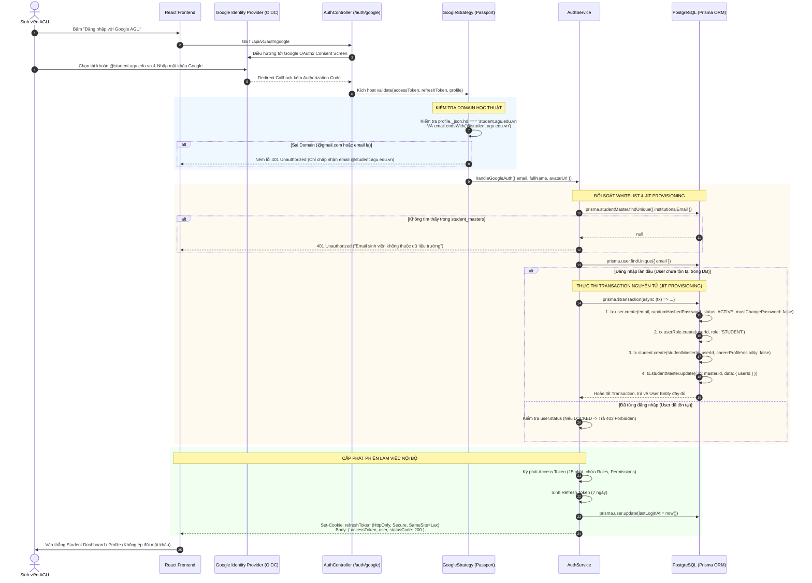

# TÀI LIỆU ĐẶC TẢ YÊU CẦU PHẦN MỀM (SRS)
## MODULE 02 — STUDENT REGISTRATION & PROFILE (ĐĂNG KÝ VÀ HỒ SƠ SINH VIÊN)
### KIẾN TRÚC XÁC THỰC GOOGLE SSO (OIDC) VÀ CẤP PHÁT ĐỘNG JUST-IN-TIME (JIT) PROVISIONING

---

| Thuộc tính | Giá trị chi tiết |
| :--- | :--- |
| **Dự án** | Hệ thống Web CRM Hỗ trợ Kết nối Sinh viên và Doanh nghiệp trong Quy trình Tuyển dụng |
| **Đơn vị bảo trợ / Khảo sát** | Trường Đại học An Giang – Đại học Quốc gia TP.HCM (AGU) |
| **Module** | Module 02 — Student Registration & Profile |
| **Mã tài liệu / Module Code** | `CRM-SRS-STU-02` / `MOD-STU` |
| **Mức độ ưu tiên** | `P0` (Bắt buộc hoàn thành trong MVP khóa luận) |
| **Phiên bản tài liệu** | `2.0.0` (Chuẩn hóa toàn diện theo kiến trúc Google SSO & JIT Provisioning) |
| **Trạng thái tài liệu** | `APPROVED BASELINE` (Sẵn sàng nghiệm thu kỹ thuật và bảo vệ khóa luận) |
| **Kiến trúc phần mềm** | Modular Monolith (NestJS + TypeScript Backend, React + Vite Frontend) |
| **Hệ quản trị CSDL & ORM** | PostgreSQL 16 (Engine) / Prisma ORM 5.x |
| **Lưu trữ tài liệu số** | MinIO Object Storage (Tương thích chuẩn AWS S3 API) |
| **Identity Provider (IdP)** | Google Workspace for Education (`@student.agu.edu.vn`) |

---

## MỤC LỤC TỔNG QUAN

1. [THÔNG TIN TÀI LIỆU VÀ LỊCH SỬ PHIÊN BẢN](#1-thông-tin-tài-liệu-và-lịch-sử-phiên-bản)
2. [BẢNG ĐỐI CHIẾU TIẾN HÓA KIẾN TRÚC (ARCHITECTURAL EVOLUTION)](#2-bảng-đối-chiếu-tiến-hóa-kiến-trúc-architectural-evolution)
3. [TỔNG QUAN, MỤC TIÊU VÀ NGUYÊN LÝ HOẠT ĐỘNG KIẾN TRÚC MỚI](#3-tổng-quan-mục-tiêu-và-nguyên-lý-hoạt-động-kiến-trúc-mới)
4. [PHẠM VI HỆ THỐNG VÀ RANH GIỚI LIÊN MODULE (SCOPE BOUNDARIES)](#4-phạm-vi-hệ-thống-và-ranh-giới-liên-module-scope-boundaries)
5. [ĐẶC TẢ ACTORS VÀ MA TRẬN TRÁCH NHIỆM](#5-đặc-tả-actors-và-ma-trận-trách-nhiệm)
6. [SƠ ĐỒ TUẦN TỰ KIẾN TRÚC GOOGLE SSO VÀ JIT PROVISIONING](#6-sơ-đồ-tuần-tự-kiến-trúc-google-sso-và-jit-provisioning)
7. [ĐẶC TẢ CƠ SỞ DỮ LIỆU & QUAN HỆ THỰC THỂ (DATA SPECIFICATION)](#7-đặc-tả-cơ-sở-dữ-liệu--quan-hệ-thực-thể-data-specification)
8. [ĐẶC TẢ YÊU CẦU CHỨC NĂNG (FUNCTIONAL REQUIREMENTS)](#8-đặc-tả-yêu-cầu-chức-năng-functional-requirements)
   - FR-STU-01: Kích hoạt tài khoản và Cấp phát hồ sơ động qua Google SSO (JIT Provisioning)
   - FR-STU-02: Quản lý hồ sơ cá nhân và Thông tin học tập cơ bản (Student Profile Management)
   - FR-STU-03: Quản lý kỹ năng, Kinh nghiệm làm việc và Dự án (Skills, Experiences & Projects)
   - FR-STU-04: Quản lý đa hồ sơ CV và Tích hợp MinIO Object Storage (Multiple CVs Management)
   - FR-STU-05: Cấu hình hiển thị và Tìm kiếm Career Profile công khai (Public Career Profile & Search)
9. [TỔNG HỢP QUY TẮC NGHIỆP VỤ (BUSINESS RULES MATRIX)](#9-tổng-hợp-quy-tắc-nghiệp-vụ-business-rules-matrix)
10. [THIẾT KẾ KỸ THUẬT VÀ GIAO THỨC LẬP TRÌNH (TECHNICAL IMPLEMENTATION)](#10-thiết-kế-kỹ-thuật-và-giao-thức-lập-trình-technical-implementation)
11. [ĐẶC TẢ GIAO DIỆN LẬP TRÌNH ỨNG DỤNG (API SPECIFICATION & PROJECTIONS)](#11-đặc-tả-giao-diện-lập-trình-ứng-dụng-api-specification--projections)
12. [YÊU CẦU AN NINH THÔNG TIN VÀ PHI CHỨC NĂNG (SECURITY & NFRS)](#12-yêu-cầu-an-ninh-thông-tin-và-phi-chức-năng-security--nfrs)
13. [DANH MỤC TRƯỜNG HỢP BIÊN VÀ KỊCH BẢN KIỂM THỬ (TEST CASES & EDGE CASES)](#13-danh-mục-trường-hợp-biên-và-kịch-bản-kiểm-thử-test-cases--edge-cases)
14. [MA TRẬN TRUY VẾT YÊU CẦU (REQUIREMENTS TRACEABILITY MATRIX - RTM)](#14-ma-trận-truy-vết-yêu-cầu-requirements-traceability-matrix---rtm)
15. [TIÊU CHÍ HOÀN THÀNH NGHIỆM THU (DEFINITION OF DONE - DOD)](#15-tiêu-chí-hoàn-thành-nghiệm-thu-definition-of-done---dod)
16. [KẾT LUẬN KIẾN TRÚC VÀ ĐÓNG GÓP KHÓA LUẬN](#16-kết-luận-kiến-trúc-và-đóng-góp-khóa-luận)

---

## 1. THÔNG TIN TÀI LIỆU VÀ LỊCH SỬ PHIÊN BẢN

### 1.1. Mục đích tài liệu
Tài liệu Đặc tả Yêu cầu Phần mềm (SRS) này xác định toàn diện các yêu cầu chức năng (FR), yêu cầu phi chức năng (NFR), cấu trúc dữ liệu 3NF, giao thức giao tiếp liên module và thiết kế kỹ thuật cho **Module 02: Student Registration & Profile**. 

Tài liệu là căn cứ pháp lý và kỹ thuật cao nhất phục vụ:
1. Phát triển mã nguồn Backend (NestJS) và Giao diện người dùng (React/Vite).
2. Xây dựng bộ kịch bản kiểm thử tự động (Unit Test, Integration Test, E2E Test).
3. Làm tài liệu bảo vệ chính thức trước Hội đồng Chấm Khóa luận Tốt nghiệp Đại học ngành Công nghệ Thông tin.

### 1.2. Lịch sử hiệu chỉnh kiến trúc
| Phiên bản | Ngày hiệu chỉnh | Tác giả thực hiện | Bản chất thay đổi | Trạng thái |
| :--- | :--- | :--- | :--- | :--- |
| `1.0.0` | 2026-06-15 | Nhóm BA & Dev | Bản phác thảo sơ bộ về quản lý Profile và CV của sinh viên. Chưa giải quyết triệt để luồng tạo tài khoản. | Obsolete |
| `1.1.0` | 2026-10-07 | Senior BA | Đề xuất cơ chế **Self-Registration**: Sinh viên tự điền Form (MSSV, Email cá nhân, Tự đặt mật khẩu) và đối soát với CSDL trường. | Superseded |
| `1.2.0` | 2026-10-23 | Lead Architect | Đề xuất cơ chế **Pre-provisioning mật khẩu tạm**: Admin nạp Excel tạo sẵn tài khoản `users`, cấp mật khẩu mặc định (CCCD/Ngày sinh) và bắt buộc đổi mật khẩu lần đầu (`must_change_password = true`). | Superseded |
| `2.0.0` | 2026-11-11 | Lead Architect & Senior BA | **Kiến trúc đột phá hiện tại**: Tích hợp **Google SSO (OpenID Connect - OIDC)** kết hợp **Just-In-Time (JIT) Provisioning**. Bỏ form đăng ký, bỏ quản lý mật khẩu sinh viên, đối soát Whitelist tự động với `student_masters`, kích hoạt tài khoản và khởi tạo hồ sơ trong 1 transaction nguyên tử. | **APPROVED BASELINE** |

---

## 2. BẢNG ĐỐI CHIẾU TIẾN HÓA KIẾN TRÚC (ARCHITECTURAL EVOLUTION)

Để phục vụ lập luận bảo vệ khóa luận tốt nghiệp, bảng dưới đây phân tích so sánh chuyên sâu 3 thế hệ kiến trúc cấp tài khoản và khởi tạo hồ sơ sinh viên tại AGU CRM:

| Tiêu chí so sánh | Mô hình v1.1.0 (Self-Registration) | Mô hình v1.2.0 (Pre-provisioning Mật khẩu tạm) | Mô hình hiện tại v2.0.0 (Google SSO + JIT Provisioning) |
| :--- | :--- | :--- | :--- |
| **Bản chất luồng (Core Mechanism)** | Sinh viên tự mở form đăng ký, nhập MSSV, email cá nhân và tự thiết lập mật khẩu ban đầu. | Nhà trường/Admin import danh sách Excel, tạo sẵn hàng loạt tài khoản `users` với mật khẩu tạm (CCCD/Ngày sinh). | **Cấp phát hồ sơ động Just-In-Time:** Sinh viên bấm "Đăng nhập với Google", Backend bắt OAuth Callback, đối soát Whitelist `student_masters` và tự động khởi tạo User/Profile ngay trong lần đăng nhập đầu tiên. |
| **Quản trị mật khẩu (Password Management)** | CRM phải tiếp nhận mật khẩu thô từ form, băm bằng Bcrypt và lưu trữ trong `users.password_hash`. Rủi ro lộ lọt khi truyền tải. | CRM lưu trữ hash mật khẩu tạm. Ép buộc sinh viên phải đổi mật khẩu ở lần đăng nhập đầu tiên (`must_change_password = true`). | **Zero Password Storage:** Toàn quyền quản lý mật khẩu do Google Identity Provider đảm nhiệm. CRM sinh chuỗi ngẫu nhiên bảo mật lưu vào `users.password_hash` để thỏa mãn ràng buộc CSDL; `must_change_password = false`. |
| **Lỗ hổng mạo danh (Impersonation Risk)** | **Cực kỳ nghiêm trọng:** MSSV là công khai trong lớp. Bất kỳ sinh viên A nào biết MSSV của sinh viên B đều có thể đăng ký trước tài khoản để chiếm đoạt. | **Rủi ro cao:** Danh sách CCCD, ngày sinh rất dễ bị lộ lọt trong danh sách sinh hoạt lớp/khoa, dẫn đến nguy cơ bị kẻ xấu đăng nhập hàng loạt tài khoản. | **Triệt tiêu hoàn toàn (Zero Trust Identity):** Chỉ người thực sự làm chủ và đăng nhập thành công vào hộp thư học thuật Google AGU (`@student.agu.edu.vn`) mới có thể kích hoạt tài khoản của chính mình. |
| **Xử lý tranh chấp đồng thời (Concurrency & Race Condition)** | Dễ xung đột tài khoản. Cần câu lệnh cập nhật nguyên tử có điều kiện `WHERE user_id IS NULL` trong Transaction. | Xung đột xảy ra tại thời điểm Admin import dữ liệu hàng loạt; phức tạp trong việc cập nhật thông tin chỉnh sửa từ Phòng Đào tạo. | **Triệt tiêu tranh chấp:** Phiên làm việc được bảo chứng duy nhất bằng Authorization Code dùng 1 lần (Single-use Auth Code) của giao thức OAuth2/OIDC. |
| **Khối lượng quản trị (Administrative Overhead)** | Hỗ trợ thủ công lớn khi sinh viên nhập sai MSSV hoặc quên mật khẩu đã tự tạo (phải làm luồng Forgot Password qua Email/SMS). | Admin liên tục phải can thiệp cấp lại mật khẩu tạm khi sinh viên quên hoặc nhập sai mật khẩu ban đầu. | **Gần như bằng 0 (Zero Admin Overhead):** Sinh viên quên mật khẩu sẽ khôi phục trực tiếp qua cơ chế của Google Workspace AGU. CRM không cần tốn tài nguyên bảo trì luồng Forgot Password cho sinh viên. |
| **Trải nghiệm người dùng (Student UX)** | Phức tạp, nhiều bước (điền form, kiểm tra mail kích hoạt, đăng nhập lại). Tỷ lệ bỏ dở cao. | Trải nghiệm gián đoạn: Bị chặn ngay ở màn hình bắt buộc đổi mật khẩu phức tạp; gây tâm lý ức chế cho sinh viên. | **Đăng nhập 1-Click (Frictionless):** Tận dụng phiên đăng nhập Google sẵn có trên trình duyệt (Chrome, Edge). Kích hoạt và vào thẳng Dashboard chỉ sau 1 cú nhấp chuột. |
| **Tính toàn vẹn dữ liệu (Data Integrity)** | Dễ sai lệch thông tin cá nhân do sinh viên tự gõ tự do (họ tên, khoa ngành). | Dữ liệu chính xác từ file import nhưng tài khoản có thể bị "rác" nếu sinh viên không bao giờ đăng nhập vào CRM. | **Tuyệt đối và Tối ưu tài nguyên:** Dữ liệu học thuật kế thừa 100% từ Master Data của Trường. Tài khoản `users` và `students` chỉ được tạo khi sinh viên thực sự có nhu cầu sử dụng hệ thống. |

---

## 3. TỔNG QUAN, MỤC TIÊU VÀ NGUYÊN LÝ HOẠT ĐỘNG KIẾN TRÚC MỚI

```
┌───────────────────────────────────────────────────────────────────────────────────────────────────┐
│                               ĐẠI HỌC AN GIANG (AGU) ECOSYSTEM                                   │
│                                                                                                   │
│   ┌────────────────────────────────┐                 ┌────────────────────────────────────────┐   │
│   │ Google Workspace for Education │                 │  Phòng Đào tạo / Trung tâm Khảo thí   │   │
│   │     (@student.agu.edu.vn)      │                 │      (Single Source of Truth)          │   │
│   │    aspmx.l.google.com          │                 │                                        │   │
│   └───────────────┬────────────────┘                 └───────────────────┬────────────────────┘   │
│                   │                                                      │                        │
│         Xác thực danh tính                                 Dữ liệu sinh viên chính quy            │
│         (Authentication IdP)                                (Master Data Pre-seeded)              │
│                   │                                                      │                        │
│                   ▼                                                      ▼                        │
│   ┌───────────────────────────────────────────────────────────────────────────────────────────┐   │
│   │                        HỆ THỐNG WEB CRM TUYỂN DỤNG SINH VIÊN AGU                         │   │
│   │                                                                                           │   │
│   │  [ Module 01: Auth & Passport ] ──► [ Bộ lọc Whitelist ] ◄── [ Bảng: student_masters ]    │   │
│   │               │                              │                                            │   │
│   │               │ (Domain & Email Hợp lệ)      │ (Kiểm tra sinh viên có trong danh sách)    │   │
│   │               ▼                              │                                            │   │
│   │  [ Just-In-Time Provisioning Engine ] ◄──────┘                                            │   │
│   │               │                                                                           │   │
│   │               ├──► Tạo tự động User: users (password ngẫu nhiên, mustChangePass = false)  │   │
│   │               ├──► Gán Quyền: user_roles (Role: 'STUDENT')                                │   │
│   │               ├──► Khởi tạo Hồ sơ: students (Liên kết student_master_id & user_id)        │   │
│   │               └──► Cập nhật Master Data: student_masters.user_id = users.id               │   │
│   │                                                                                           │   │
│   │  [ Module 02: Student Profile ] ──► Quản lý Skills, Experience, Projects, CVs, Visibility │   │
│   └───────────────────────────────────────────────────────────────────────────────────────────┘   │
└───────────────────────────────────────────────────────────────────────────────────────────────────┘
```

### 3.1. Ranh giới giữa Xác thực (Authentication) và Ủy quyền/Dữ liệu gốc (Authorization & Master Data)
1. **Identity Provider (Google Workspace for Education):**
   - Tên miền email của sinh viên AGU có định dạng `@student.agu.edu.vn`. Toàn bộ hạ tầng định tuyến thư điện tử vận hành trên cụm máy chủ MX của Google (`aspmx.l.google.com`).
   - Google IdP chịu trách nhiệm xác thực danh tính: Chứng minh người dùng đang tương tác thực sự là chủ sở hữu hợp pháp của hộp thư. CRM tuyệt đối không lưu trữ, không quản lý và không can thiệp vào mật khẩu của sinh viên.
2. **Single Source of Truth (`student_masters`):**
   - Toàn bộ thông tin học thuật gốc (Mã số sinh viên - MSSV, Họ và tên khai sinh, Ngành đào tạo, Khoa, Khóa tuyển sinh, Email trường) do Phòng Đào tạo AGU cung cấp và được nạp sẵn vào bảng `student_masters`.
   - Sinh viên không được phép tự do chỉnh sửa các trường dữ liệu học thuật này nhằm bảo vệ tính toàn vẹn và uy tín của hồ sơ ứng tuyển.
3. **Bộ lọc ủy quyền Whitelist (Authorization Filter):**
   - Một tài khoản Google dù đăng nhập thành công nhưng nếu địa chỉ email không tồn tại trong bảng `student_masters` (ví dụ: cựu sinh viên đã bị xóa dữ liệu, sinh viên thôi học, hoặc tài khoản ngoài danh mục tuyển sinh), hệ thống sẽ từ chối cấp quyền truy cập ngay lập tức (`401 Unauthorized`).

### 3.2. Kỹ thuật Cấp phát động Just-In-Time (JIT) Provisioning
Just-In-Time (JIT) Provisioning là kỹ thuật cấp phát tài khoản và khởi tạo thực thể dữ liệu ngay tại thời điểm có sự kiện xác thực thành công lần đầu tiên từ Identity Provider bên ngoài.
- Khi sinh viên AGU bấm **"Đăng nhập với Google"** lần đầu tiên:
  1. Passport Google Strategy trích xuất thông tin hồ sơ OIDC (Email, Display Name, Hosted Domain).
  2. Hệ thống kiểm tra Hosted Domain (`hd === 'student.agu.edu.vn'`).
  3. Hệ thống đối soát Whitelist trong `student_masters`.
  4. Nếu chưa có bản ghi trong bảng `users`, hệ thống tự động kích hoạt một **Prisma Database Transaction** nguyên tử để tạo tài khoản `users`, gán vai trò `STUDENT`, khởi tạo thực thể `students` và cập nhật khóa ngoại hai chiều.
  5. Cấp phát bộ đôi Token nội bộ (Access Token 15 phút + Refresh Token 7 ngày trong HttpOnly Cookie).
- Ở các lần đăng nhập tiếp theo ($n \ge 2$), hệ thống chỉ việc nhận diện tài khoản đã tồn tại, cập nhật mốc thời gian `last_login_at` và cấp token mới mà không tạo thêm bất kỳ bản ghi dư thừa nào.

---

## 4. PHẠM VI HỆ THỐNG VÀ RANH GIỚI LIÊN MODULE (SCOPE BOUNDARIES)

### 4.1. In-Scope (Phạm vi nghiệp vụ Module 02)
1. **Kích hoạt tài khoản và Khởi tạo Profile (JIT Provisioning Interface):** Phối hợp cùng Module 01 để tự động cấp phát thực thể `students` ngay khi sinh viên đăng nhập Google lần đầu.
2. **Quản lý Hồ sơ năng lực cá nhân (Student Profile):** Cho phép sinh viên xem thông tin học thuật gốc (chế độ chỉ đọc - Read-only), cập nhật thông tin liên hệ và bổ sung tiểu sử (Bio, Số điện thoại, Địa chỉ, GPA mong muốn hiển thị).
3. **Quản lý Kỹ năng (Skills):** Thêm, sửa, xóa các thẻ kỹ năng chuyên môn và đánh giá mức độ thành thạo (Proficiency).
4. **Quản lý Kinh nghiệm làm việc (Experiences):** Ghi nhận quá trình làm việc, thực tập, vị trí đảm nhiệm và mốc thời gian (start_date, end_date).
5. **Quản lý Dự án cá nhân (Projects):** Trình bày các dự án học tập, đề tài nghiên cứu khoa học, công nghệ sử dụng, vai trò và đường dẫn sản phẩm (project_url).
6. **Quản lý Đa hồ sơ CV (Multiple CVs):** Cho phép tải lên nhiều bản CV (PDF) lên MinIO S3 Object Storage, đặt tên phân loại (Frontend CV, Backend CV) và thiết lập duy nhất 1 bản CV mặc định (Default CV).
7. **Quản lý Trạng thái hiển thị (Career Profile Visibility):** Sinh viên chủ động bật/tắt quyền cho phép Nhà tuyển dụng tìm kiếm hồ sơ năng lực của mình trên thị trường việc làm AGU.
8. **Tìm kiếm Hồ sơ nghề nghiệp công khai (Public Career Profile Search):** Cung cấp công cụ tìm kiếm và trình chiếu DTO hồ sơ công khai dành riêng cho Employer và Career Center (chỉ lọc các sinh viên bật Visibility).

### 4.2. Out-of-Scope (Ngoại phạm vi MVP)
- Đánh giá hồ sơ tự động bằng Trí tuệ nhân tạo (AI Profile Matching & Job Recommendation) — *Định hướng P2*.
- Phân tích khoảng cách kỹ năng (Skill Gap Analysis) — *Định hướng P2*.
- Tìm kiếm ngữ nghĩa bằng AI (Vector Search / Semantic Search) — *Định hướng P2*.
- Quản lý bảng điểm điện tử chi tiết (Transcript Management) và chứng chỉ số (Certificate Verification) — *Định hướng P1*.
- Đa trường đại học (Multi-university) — Hệ thống được tối ưu hóa chuyên biệt cho Trường Đại học An Giang (AGU).

### 4.3. Ranh giới phối hợp giữa Module 01 (Auth) và Module 02 (Student)
Trong kiến trúc Modular Monolith của hệ thống:
- **Module 01 (AuthModule):**
  - Đóng vai trò là cửa ngõ bảo mật (Security Gateway). Tiếp nhận OAuth Callback từ Google, giải mã Id Token/Profile, kiểm tra Hosted Domain `student.agu.edu.vn`.
  - Quản lý bảng `users`, `user_roles`, `roles`, `permissions` và cấp phát JWT / HttpOnly Cookie.
- **Module 02 (StudentModule):**
  - Sở hữu và chịu trách nhiệm nghiệp vụ trên các bảng: `student_masters`, `students`, `student_skills`, `student_experiences`, `student_projects`, `student_cvs`.
  - Cung cấp Public Service Interface `StudentProvisioningService` để `AuthService` điều phối gọi trong **cùng một Database Transaction**, bảo đảm nguyên tắc cô lập module nhưng vẫn cam kết tính nhất quán dữ liệu ACID.

```text
HTTP GET /api/v1/auth/google/callback
         │
         ▼
 ┌──────────────┐
 │ AuthModule   │ ──(1. Validate Token & Domain)──► Google Strategy
 └──────┬───────┘
        │
        ▼ (2. Execute in Prisma Transaction)
 ┌─────────────────────────────────────────────────────────────┐
 │ Transaction Context (tx)                                    │
 │  ├── Auth:    tx.user.create()                              │
 │  ├── Auth:    tx.userRole.create()                          │
 │  ├── Student: tx.student.create()                           │
 │  └── Student: tx.studentMaster.update(userId = newUser.id)   │
 └──────────────────────────────┬──────────────────────────────┘
                                │
                                ▼ (3. Issue Tokens)
                     Dual-Tokens to Client
```

---

## 5. ĐẶC TẢ ACTORS VÀ MA TRẬN TRÁCH NHIỆM

| Actor | Vai trò & Thẩm quyền trong Module 02 | Phạm vi kiểm soát dữ liệu |
| :--- | :--- | :--- |
| **Student (Sinh viên)** | - Đăng nhập 1-Click qua Google SSO AGU.<br>- Sở hữu và toàn quyền CRUD trên Skills, Experiences, Projects, CVs của chính mình.<br>- Bật/tắt cờ `career_profile_visibility`.<br>- Xem thông tin học thuật gốc (Read-only). | Chỉ có quyền truy cập và thao tác trên Resource thuộc quyền sở hữu (`user_id = currentUser.id`). Tuyệt đối không can thiệp hồ sơ sinh viên khác. |
| **Employer / Recruiter (Nhà tuyển dụng)** | - Tìm kiếm hồ sơ năng lực của sinh viên theo Ngành, Kỹ năng, Dự án.<br>- Xem Career Profile công khai của các sinh viên bật `career_profile_visibility = true`. | Chỉ truy cập được dữ liệu công khai (Public Projection DTO). Bị chặn truy cập các thông tin riêng tư (Số điện thoại, Địa chỉ, CV cá nhân) trừ khi sinh viên đã chủ động nộp hồ sơ vào tin tuyển dụng của công ty. |
| **Career Center (Trung tâm Hướng nghiệp AGU)** | - Giám sát tổng thể hoạt động hồ sơ sinh viên.<br>- Tìm kiếm sinh viên phục vụ công tác giới thiệu việc làm và báo cáo thống kê tỷ lệ việc làm theo khoa/ngành. | Xem thông tin hồ sơ theo chính sách nghiệp vụ của Nhà trường (Institutional Governance). Không can thiệp sửa đổi trái phép dữ liệu cá nhân của sinh viên. |
| **System Admin (Quản trị viên Hệ thống)** | - Cấu hình tích hợp hệ thống Google OAuth Client ID/Secret.<br>- Nạp dữ liệu danh sách sinh viên ban đầu (`student_masters`) qua file Excel hoặc API nội bộ.<br>- Khóa/Mở khóa tài khoản `users.status` khi có yêu cầu xử lý vi phạm kỷ luật. | Toàn quyền cấu hình kỹ thuật; không đại diện cho sinh viên để chỉnh sửa thông tin nghề nghiệp. |

---

## 6. SƠ ĐỒ TUẦN TỰ KIẾN TRÚC GOOGLE SSO VÀ JIT PROVISIONING

Sơ đồ dưới đây mô tả chính xác quy trình tương tác giữa Trình duyệt sinh viên, Google Identity Provider, NestJS Backend (AuthController, AuthService, Passport Google Strategy) và Cơ sở dữ liệu PostgreSQL qua Prisma ORM:



---

## 7. ĐẶC TẢ CƠ SỞ DỮ LIỆU & QUAN HỆ THỰC THỂ (DATA SPECIFICATION)

Cơ sở dữ liệu Module 02 được thiết kế tuân thủ nghiêm ngặt **Chuẩn hóa dạng 3 (3NF)**, bảo đảm tính toàn vẹn quan hệ (Referential Integrity) và phân định rõ ràng giữa **Dữ liệu đào tạo bất biến** và **Dữ liệu hồ sơ ứng tuyển cá nhân**.

### 7.1. Sơ đồ Quan hệ Thực thể (Entity Relationship Diagram - ERD)

```text
┌─────────────────────────┐               ┌─────────────────────────────────┐
│         users           │               │         student_masters         │
├─────────────────────────┤               ├─────────────────────────────────┤
│ id (PK, UUID)           │ 1           1 │ id (PK, UUID)                   │
│ email (UQ, VarChar)     ├───────────────┤ student_code (UQ, VarChar(30))  │
│ password_hash (VarChar) │   user_id     │ full_name (VarChar(150))        │
│ status (user_status)    │   (UQ, UUID)  │ institutional_email (UQ, VarChar│
│ must_change_password    │               │ major (VarChar(150))            │
│ last_login_at           │               │ faculty (VarChar(150), Nullable)│
│ created_at / updated_at │               │ academic_year (Int, Nullable)   │
└───────────┬─────────────┘               │ citizen_id (UQ, VarChar, Null)  │
            │                             │ date_of_birth (Date, Nullable)  │
            │                             │ status (student_status)         │
            │ 1                           │ user_id (UQ, UUID, FK -> users) │
            │                             └────────────────┬────────────────┘
            │                                              │ 1
            │ 1                                            │
            ▼                                              ▼ 1
┌───────────────────────────────────────────────────────────┐
│                         students                          │
├───────────────────────────────────────────────────────────┤
│ id (PK, UUID)                                             │
│ student_master_id (UQ, UUID, FK -> student_masters.id)    │
│ user_id (UQ, UUID, FK -> users.id)                        │
│ phone (VarChar(30), Nullable)                             │
│ bio (Text, Nullable)                                      │
│ address (VarChar(255), Nullable)                          │
│ date_of_birth (Date, Nullable)                            │
│ gender (VarChar(30), Nullable)                            │
│ gpa (Decimal(3,2), Nullable)                              │
│ career_profile_visibility (Boolean, Default: false)       │
│ created_at / updated_at (Timestamptz)                     │
└───────────┬───────────────────┬───────────────────┬───────┘
            │ 1                 │ 1                 │ 1
            │                   │                   │
            ▼ N                 ▼ N                 ▼ N
┌───────────────────────┐ ┌───────────────────┐ ┌───────────────────────────┐
│    student_skills     │ │student_experiences│ │     student_projects      │
├───────────────────────┤ ├───────────────────┤ ├───────────────────────────┤
│ id (PK, UUID)         │ │ id (PK, UUID)     │ │ id (PK, UUID)             │
│ student_id (FK, UUID) │ │ student_id (FK)   │ │ student_id (FK, UUID)     │
│ skill_name (VarChar)  │ │ company_name      │ │ name (VarChar(200))       │
│ proficiency (VarChar) │ │ position          │ │ description (Text)        │
│ created_at            │ │ start_date (Date) │ │ role (VarChar(100))       │
└───────────────────────┘ │ end_date (Date)   │ │ technologies (Text)       │
                          │ description (Text)│ │ project_url (VarChar(500))│
                          └───────────────────┘ │ start_date / end_date     │
                                                └───────────────────────────┘
                                                            │ 1
                                                            │
                                                            ▼ N
                                                ┌───────────────────────────┐
                                                │       student_cvs         │
                                                ├───────────────────────────┤
                                                │ id (PK, UUID)             │
                                                │ student_id (FK, UUID)     │
                                                │ file_id (FK -> files.id)  │
                                                │ title (VarChar(150))      │
                                                │ is_default (Boolean)      │
                                                │ created_at / updated_at   │
                                                └─────────────┬─────────────┘
                                                              │ N
                                                              │
                                                              ▼ 1
                                                ┌───────────────────────────┐
                                                │           files           │
                                                ├───────────────────────────┤
                                                │ id (PK, UUID)             │
                                                │ original_name (VarChar)   │
                                                │ storage_key (VarChar(500))│
                                                │ mime_type (VarChar(100))  │
                                                │ size_bytes (BigInt)       │
                                                │ bucket_name (VarChar(100))│
                                                │ owner_user_id (UUID)      │
                                                └───────────────────────────┘
```

### 7.2. Đặc tả chi tiết các bảng CSDL

#### 7.2.1. Bảng `student_masters` (Dữ liệu học thuật gốc)
- **Ý nghĩa:** Chứa danh sách sinh viên chính quy do Nhà trường quản lý. Sinh viên hoàn toàn không có quyền sửa đổi hay chèn mới vào bảng này.
- **Tên bảng vật lý:** `student_masters`

| Tên cột | Kiểu dữ liệu | Ràng buộc | Mô tả chi tiết |
| :--- | :--- | :--- | :--- |
| `id` | `UUID` | `PRIMARY KEY`, Default: `gen_random_uuid()` | Khóa chính đại diện kỹ thuật (Surrogate Key). |
| `student_code` | `VARCHAR(30)` | `NOT NULL`, `UNIQUE (uq_student_masters_code)` | Mã số sinh viên (MSSV) — Khóa tự nhiên (Natural Key). |
| `full_name` | `VARCHAR(150)` | `NOT NULL` | Họ và tên khai sinh của sinh viên theo hồ sơ nhập học. |
| `institutional_email`| `VARCHAR(255)`| `NOT NULL`, `UNIQUE (uq_student_masters_inst_email)` | Hộp thư điện tử trường cấp (`@student.agu.edu.vn`) dùng đối soát SSO. |
| `major` | `VARCHAR(150)` | `NOT NULL` | Ngành đào tạo (ví dụ: Công nghệ thông tin, Kỹ thuật phần mềm). |
| `faculty` | `VARCHAR(150)` | `NULL` | Khoa chủ quản (ví dụ: Khoa Công nghệ Thông tin). |
| `academic_year` | `INTEGER` | `NULL` | Khóa tuyển sinh (ví dụ: `24` ứng với Khóa 24 - ĐH24). |
| `citizen_id` | `VARCHAR(20)` | `NULL`, `UNIQUE (uq_student_masters_citizen_id)` | Số Căn cước công dân / Mã định danh cá nhân. |
| `date_of_birth` | `DATE` | `NULL` | Ngày tháng năm sinh theo khai sinh. |
| `status` | `student_status`| `NOT NULL`, Default: `'ACTIVE'` | Trạng thái học tập: `ACTIVE`, `GRADUATED`, `SUSPENDED`. |
| `user_id` | `UUID` | `NULL`, `UNIQUE (uq_student_masters_user)` | Khóa ngoại liên kết 1-1 tới bảng `users.id` khi tài khoản được kích hoạt. |
| `created_at` | `TIMESTAMPTZ` | `NOT NULL`, Default: `NOW()` | Mốc thời gian nạp dữ liệu. |
| `updated_at` | `TIMESTAMPTZ` | `NOT NULL`, Default: `NOW()` | Mốc thời gian cập nhật gần nhất. |

#### 7.2.2. Bảng `students` (Hồ sơ năng lực cá nhân của Sinh viên)
- **Ý nghĩa:** Bảng trung tâm của Module 02, đại diện cho hồ sơ nghề nghiệp do chính sinh viên quản lý và hoàn thiện để ứng tuyển việc làm.
- **Tên bảng vật lý:** `students`

| Tên cột | Kiểu dữ liệu | Ràng buộc | Mô tả chi tiết |
| :--- | :--- | :--- | :--- |
| `id` | `UUID` | `PRIMARY KEY`, Default: `gen_random_uuid()` | Khóa chính định danh thực thể hồ sơ sinh viên. |
| `student_master_id`| `UUID` | `NOT NULL`, `UNIQUE (uq_students_master)`, FK trỏ `student_masters.id` | Liên kết 1-1 bắt buộc tới dữ liệu học thuật gốc. `ON DELETE RESTRICT`. |
| `user_id` | `UUID` | `NOT NULL`, `UNIQUE (uq_students_user)`, FK trỏ `users.id` | Liên kết 1-1 bắt buộc tới tài khoản định danh xác thực. `ON DELETE RESTRICT`. |
| `phone` | `VARCHAR(30)` | `NULL` | Số điện thoại liên lạc cá nhân của sinh viên. |
| `bio` | `TEXT` | `NULL` | Giới thiệu ngắn về mục tiêu nghề nghiệp cá nhân. |
| `address` | `VARCHAR(255)` | `NULL` | Địa chỉ cư trú / quê quán hiện tại. |
| `date_of_birth` | `DATE` | `NULL` | Ngày sinh do sinh viên cập nhật thêm nếu cần. |
| `gender` | `VARCHAR(30)` | `NULL` | Giới tính (Nam, Nữ, Khác). |
| `gpa` | `DECIMAL(3,2)` | `NULL` | Điểm trung bình tích lũy hệ 4 (ví dụ: 3.52) — Tùy chọn hiển thị. |
| `career_profile_visibility`| `BOOLEAN`| `NOT NULL`, Default: `false` | Cờ bật/tắt hiển thị Profile cho Nhà tuyển dụng tìm kiếm. Mặc định tắt để bảo vệ quyền riêng tư. |
| `created_at` | `TIMESTAMPTZ` | `NOT NULL`, Default: `NOW()` | Thời điểm tạo hồ sơ. |
| `updated_at` | `TIMESTAMPTZ` | `NOT NULL`, Default: `NOW()` | Thời điểm cập nhật hồ sơ gần nhất. |

#### 7.2.3. Bảng `student_skills` (Kỹ năng chuyên môn)
- **Tên bảng vật lý:** `student_skills`
- **Quan hệ:** Nhiều-1 với `students` (`student_id` FK trỏ `students.id`, `ON DELETE CASCADE`).
- **Ràng buộc duy nhất:** `@@unique([studentId, skillName], map: "uq_student_skills_name")` — Ngăn ngừa việc một sinh viên thêm trùng một kỹ năng nhiều lần.

| Tên cột | Kiểu dữ liệu | Ràng buộc | Mô tả chi tiết |
| :--- | :--- | :--- | :--- |
| `id` | `UUID` | `PRIMARY KEY`, Default: `gen_random_uuid()` | Khóa chính. |
| `student_id` | `UUID` | `NOT NULL`, FK trỏ `students.id` | ID hồ sơ sinh viên sở hữu. |
| `skill_name` | `VARCHAR(100)` | `NOT NULL` | Tên kỹ năng (ví dụ: ReactJS, TypeScript, NestJS, Docker). |
| `proficiency` | `VARCHAR(30)` | `NULL` | Mức độ thành thạo (ví dụ: Cơ bản, Khá, Thành thạo, Chuyên gia). |
| `created_at` | `TIMESTAMPTZ` | `NOT NULL`, Default: `NOW()` | Thời điểm gán kỹ năng. |

#### 7.2.4. Bảng `student_experiences` (Kinh nghiệm làm việc & Thực tập)
- **Tên bảng vật lý:** `student_experiences`
- **Quan hệ:** Nhiều-1 với `students` (`student_id` FK trỏ `students.id`, `ON DELETE CASCADE`).
- **Chỉ mục tối ưu:** `@@index([studentId, startDate(sort: Desc)])` — Tối ưu hóa truy vấn render timeline kinh nghiệm làm việc theo thứ tự mới nhất xếp trước.

| Tên cột | Kiểu dữ liệu | Ràng buộc | Mô tả chi tiết |
| :--- | :--- | :--- | :--- |
| `id` | `UUID` | `PRIMARY KEY`, Default: `gen_random_uuid()` | Khóa chính. |
| `student_id` | `UUID` | `NOT NULL`, FK trỏ `students.id` | ID hồ sơ sinh viên sở hữu. |
| `company_name` | `VARCHAR(150)` | `NOT NULL` | Tên doanh nghiệp/tổ chức từng làm việc hoặc thực tập. |
| `position` | `VARCHAR(150)` | `NOT NULL` | Vị trí công việc (ví dụ: Thực tập sinh Backend, Cộng tác viên IT). |
| `start_date` | `DATE` | `NOT NULL` | Ngày bắt đầu làm việc. |
| `end_date` | `DATE` | `NULL` | Ngày kết thúc (`NULL` thể hiện hiện tại vẫn đang làm việc tại đây). |
| `description` | `TEXT` | `NULL` | Mô tả chi tiết công việc, thành tích đạt được. |
| `created_at` | `TIMESTAMPTZ` | `NOT NULL`, Default: `NOW()` | Thời điểm ghi nhận. |

#### 7.2.5. Bảng `student_projects` (Dự án thực tế & Đề tài học tập)
- **Tên bảng vật lý:** `student_projects`
- **Quan hệ:** Nhiều-1 với `students` (`student_id` FK trỏ `students.id`, `ON DELETE CASCADE`).
- **Chỉ mục tối ưu:** `@@index([studentId])`.

| Tên cột | Kiểu dữ liệu | Ràng buộc | Mô tả chi tiết |
| :--- | :--- | :--- | :--- |
| `id` | `UUID` | `PRIMARY KEY`, Default: `gen_random_uuid()` | Khóa chính. |
| `student_id` | `UUID` | `NOT NULL`, FK trỏ `students.id` | ID hồ sơ sinh viên sở hữu. |
| `name` | `VARCHAR(200)` | `NOT NULL` | Tên dự án (ví dụ: Website Thương mại điện tử AGU E-Shop). |
| `description` | `TEXT` | `NULL` | Mô tả bài toán và giải pháp của dự án. |
| `role` | `VARCHAR(100)` | `NULL` | Vai trò trong dự án (ví dụ: Trưởng nhóm, Fullstack Developer). |
| `technologies` | `TEXT` | `NULL` | Danh sách công nghệ sử dụng (ví dụ: React, NestJS, PostgreSQL). |
| `project_url` | `VARCHAR(500)` | `NULL` | Liên kết mã nguồn GitHub hoặc đường dẫn Demo sản phẩm. |
| `start_date` | `DATE` | `NULL` | Ngày bắt đầu thực hiện dự án. |
| `end_date` | `DATE` | `NULL` | Ngày hoàn thành dự án (`NULL` nếu đang phát triển). |
| `created_at` | `TIMESTAMPTZ` | `NOT NULL`, Default: `NOW()` | Thời điểm tạo dự án. |

#### 7.2.6. Bảng `student_cvs` (Quản lý đa hồ sơ CV ứng tuyển)
- **Tên bảng vật lý:** `student_cvs`
- **Quan hệ:** Nhiều-1 với `students` (`student_id` FK trỏ `students.id`, `ON DELETE CASCADE`) và Nhiều-1 với `files` (`file_id` FK trỏ `files.id`, `ON DELETE RESTRICT`).
- **Ràng buộc nghiệp vụ:** Mỗi sinh viên chỉ có tối đa một bản ghi mang `is_default = true`. Ràng buộc này được thực thi thông qua Partial Unique Index trong PostgreSQL:
  ```sql
  CREATE UNIQUE INDEX uq_student_default_cv 
  ON student_cvs (student_id) 
  WHERE is_default = TRUE;
  ```

| Tên cột | Kiểu dữ liệu | Ràng buộc | Mô tả chi tiết |
| :--- | :--- | :--- | :--- |
| `id` | `UUID` | `PRIMARY KEY`, Default: `gen_random_uuid()` | Khóa chính hồ sơ CV. |
| `student_id` | `UUID` | `NOT NULL`, FK trỏ `students.id` | ID hồ sơ sinh viên sở hữu. |
| `file_id` | `UUID` | `NOT NULL`, FK trỏ `files.id` | Khóa ngoại tham chiếu file lưu trữ trong bảng `files`. |
| `title` | `VARCHAR(150)` | `NOT NULL` | Tiêu đề phân loại CV (ví dụ: CV Kỹ sư Cầu nối, CV Web Developer). |
| `is_default` | `BOOLEAN` | `NOT NULL`, Default: `false` | Cờ đánh dấu bản CV chính dùng để ứng tuyển nhanh. |
| `created_at` | `TIMESTAMPTZ` | `NOT NULL`, Default: `NOW()` | Thời điểm tải lên. |
| `updated_at` | `TIMESTAMPTZ` | `NOT NULL`, Default: `NOW()` | Thời điểm cập nhật thông tin CV gần nhất. |

---

## 8. ĐẶC TẢ YÊU CẦU CHỨC NĂNG (FUNCTIONAL REQUIREMENTS)

### FR-STU-01: Kích hoạt tài khoản và Cấp phát hồ sơ động qua Google SSO (JIT Provisioning)
- **Mã yêu cầu:** `FR-STU-01`
- **Mức độ ưu tiên:** `P0 (Bắt buộc)`
- **Actor:** Sinh viên AGU có tài khoản Google trường (`@student.agu.edu.vn`).
- **Mục tiêu:** Tự động tạo định danh tài khoản và cấp phát hồ sơ sinh viên ngay trong lần đăng nhập đầu tiên mà không yêu cầu điền biểu mẫu đăng ký hay đổi mật khẩu cục bộ.
- **Tiền điều kiện:** 
  1. Hộp thư email của sinh viên thuộc Hosted Domain `student.agu.edu.vn`.
  2. Địa chỉ email tồn tại trong bảng dữ liệu gốc `student_masters`.
  3. Trạng thái học tập của sinh viên thỏa mãn chính sách cấp tài khoản (`student_masters.status = 'ACTIVE'`).
- **Luồng xử lý chi tiết:**
  1. Hệ thống tiếp nhận thông tin từ Google Callback: `{ email, fullName, avatarUrl }`.
  2. Đối soát dữ liệu gốc: Tìm kiếm bản ghi trong `student_masters` theo `institutional_email = email`. Nếu không thấy, từ chối cấp quyền với lỗi `401 Unauthorized`.
  3. Kiểm tra trạng thái tài khoản: Tìm kiếm trong `users` theo `email`.
  4. Nếu tài khoản chưa tồn tại: Khởi tạo khối lệnh `prisma.$transaction`:
     - Tạo bản ghi mới trên bảng `users` với:
       - `email = email` (chuẩn hóa chữ thường).
       - `password_hash = hashPassword(randomUUID())` (Mật khẩu băm ngẫu nhiên có độ dài và entropy cao, thỏa mãn ràng buộc `NOT NULL` của CSDL).
       - `status = 'ACTIVE'`.
       - `must_change_password = false`.
     - Tìm kiếm Role ID của mã `STUDENT` trong bảng `roles`.
     - Tạo bản ghi trong `user_roles` gán quyền `STUDENT` cho User vừa tạo.
     - Tạo bản ghi mới trên bảng `students` với `studentMasterId = master.id`, `userId = newUser.id`, `careerProfileVisibility = false`.
     - Cập nhật liên kết ngược trên `student_masters.user_id = newUser.id`.
  5. Nếu tài khoản đã tồn tại: Kiểm tra `users.status`. Nếu `LOCKED` thì chặn bằng `403 Forbidden`.
  6. Ký phát bộ đôi Access Token (15 phút) và Refresh Token (7 ngày).
  7. Cập nhật `users.last_login_at = NOW()`.
- **Hậu điều kiện:** Sinh viên nhận được phiên làm việc hợp lệ, hồ sơ cá nhân đã sẵn sàng trong cơ sở dữ liệu.

### FR-STU-02: Quản lý hồ sơ cá nhân và Thông tin học tập cơ bản
- **Mã yêu cầu:** `FR-STU-02`
- **Mức độ ưu tiên:** `P0`
- **Actor:** Sinh viên đang đăng nhập.
- **Mục tiêu:** Cho phép sinh viên xem toàn bộ dữ liệu học thuật gốc (Read-only) và cập nhật các thông tin liên hệ, giới thiệu bản thân.
- **Đặc tả chi tiết:**
  1. **Thông tin Read-only (Bất biến từ `student_masters`):** MSSV (`student_code`), Họ và tên (`full_name`), Email trường (`institutional_email`), Ngành học (`major`), Khoa (`faculty`), Niên khóa (`academic_year`), Trạng thái học tập (`status`). Sinh viên không thể thay đổi các trường này qua API.
  2. **Thông tin Editable (Sinh viên tự cập nhật trên `students`):** Số điện thoại (`phone`), Tiểu sử nghề nghiệp (`bio`), Địa chỉ cư trú (`address`), Giới tính (`gender`), Ngày sinh (`date_of_birth`), Điểm trung bình tích lũy hiển thị (`gpa`).
  3. **Kiểm tra tính hợp lệ (Validation):**
     - `phone`: Phải đúng định dạng số điện thoại Việt Nam (10 chữ số, bắt đầu bằng đầu số hợp lệ `03, 05, 07, 08, 09`).
     - `gpa`: Nằm trong thang điểm 4.00, từ `0.00` đến `4.00`, tối đa 2 chữ số thập phân.
     - `bio`: Độ dài tối đa 2000 ký tự.

### FR-STU-03: Quản lý Kỹ năng, Kinh nghiệm làm việc và Dự án thực tế
- **Mã yêu cầu:** `FR-STU-03`
- **Mức độ ưu tiên:** `P0`
- **Actor:** Sinh viên đang đăng nhập.
- **Mục tiêu:** Cung cấp bộ công cụ trực quan để sinh viên chuẩn bị hồ sơ năng lực đầy đủ nhằm tăng khả năng kết nối với nhà tuyển dụng.
- **Đặc tả chi tiết:**
  1. **Kỹ năng (`student_skills`):**
     - Sinh viên có thể tạo mới, chỉnh sửa, xóa kỹ năng.
     - Tên kỹ năng không được để trống và không vượt quá 100 ký tự.
     - Hệ thống ngăn chặn việc thêm trùng lặp kỹ năng cho cùng một sinh viên.
  2. **Kinh nghiệm làm việc (`student_experiences`):**
     - Sinh viên thêm các mốc kinh nghiệm: Tên công ty, Vị trí công việc, Ngày bắt đầu (`start_date`), Ngày kết thúc (`end_date`), Mô tả công việc.
     - **Quy tắc thời gian:** Nếu `end_date` khác `null`, hệ thống bắt buộc kiểm tra `end_date >= start_date`. Nếu vi phạm, trả mã lỗi `400 Bad Request`.
     - Cho phép `end_date = null` để biểu thị vị trí công việc hiện tại.
  3. **Dự án cá nhân (`student_projects`):**
     - Sinh viên thêm các dự án: Tên dự án, Vai trò, Công nghệ sử dụng, Đường dẫn URL dự án, Mốc thời gian thực hiện.
     - `project_url` nếu có phải đúng định dạng HTTP/HTTPS hợp lệ.

### FR-STU-04: Quản lý Đa hồ sơ CV và Tích hợp MinIO Object Storage
- **Mã yêu cầu:** `FR-STU-04`
- **Mức độ ưu tiên:** `P0`
- **Actor:** Sinh viên đang đăng nhập.
- **Mục tiêu:** Cho phép sinh viên lưu trữ nhiều phiên bản CV ứng tuyển dưới dạng tệp tin PDF, phục vụ cho từng vị trí tuyển dụng chuyên biệt.
- **Đặc tả chi tiết:**
  1. **Tải lên CV (Upload CV):**
     - Chỉ chấp nhận định dạng tệp tin PDF (`mime_type = application/pdf`).
     - Giới hạn dung lượng tệp: Tối đa 5MB (`size_bytes <= 5242880`).
     - Tệp tin nhị phân được truyền phát trực tiếp và lưu trữ an toàn trên MinIO S3 Object Storage dưới Bucket private `agu-crm-storage`.
     - Đường dẫn lưu trữ (`storage_key`) có định dạng phân cấp không đoán trước: `resumes/{student_id}/{uuid}.pdf`.
     - Bucket phải luôn ở chế độ private; chỉ Backend được cấp presigned URL có thời hạn ngắn để truy cập tệp.
     - Bảng `files` lưu metadata của tệp; bảng `student_cvs` lưu thông tin ngữ cảnh ứng tuyển (`title`, `is_default`).
  2. **Quản lý CV mặc định (Default CV Setting):**
     - Sinh viên được quyền thiết lập 1 bản CV làm mặc định (`is_default = true`).
     - Khi sinh viên chọn một CV mới làm mặc định, hệ thống tự động cập nhật bản CV mặc định cũ về `is_default = false` trong cùng một transaction.
     - Đảm bảo quy tắc bất biến: Tại mọi thời điểm, một sinh viên chỉ có tối đa 1 bản CV mặc định.
  3. **Toàn vẹn ứng tuyển (Application Immutability):**
     - Khi sinh viên nộp hồ sơ vào tin tuyển dụng (Module 04 - Job Application), hệ thống lưu trực tiếp khóa ngoại của bản ghi `student_cvs.id` tại thời điểm nộp.
     - Việc sinh viên sau đó xóa CV hoặc đổi CV mặc định tuyệt đối không làm thay đổi hay mất mát tệp CV mà Nhà tuyển dụng đang xem xét trong đơn ứng tuyển lịch sử.

### FR-STU-05: Cấu hình hiển thị và Tìm kiếm Career Profile công khai
- **Mã yêu cầu:** `FR-STU-05`
- **Mức độ ưu tiên:** `P0`
- **Actor:** Sinh viên, Nhà tuyển dụng (Employer), Ban Hướng nghiệp (Career Center).
- **Mục tiêu:** Kết nối sinh viên có nhu cầu tìm việc với doanh nghiệp mà vẫn bảo đảm tuyệt đối quyền riêng tư dữ liệu cá nhân.
- **Đặc tả chi tiết:**
  1. **Quyền riêng tư (Privacy Toggle):** Sinh viên chủ động cấu hình `career_profile_visibility` (Bật / Tắt).
  2. **Tìm kiếm hồ sơ công khai (Public Search):**
     - Employer chỉ có thể tìm thấy và xem hồ sơ của các sinh viên có `career_profile_visibility = true` VÀ `users.status = 'ACTIVE'` VÀ `student_masters.status = 'ACTIVE'`.
     - Bộ lọc tìm kiếm hỗ trợ: Theo Ngành đào tạo (`major`), Thẻ kỹ năng (`skillName`), Mức độ thành thạo, Khóa tuyển sinh.
  3. **Phân tách DTO Công khai (Public/Private Data Projection):**
     - API Public Career Profile tuyệt đối không trả về các thông tin nhạy cảm: Số điện thoại, Địa chỉ cư trú, Căn cước công dân, File CV riêng tư, Mật khẩu băm.
     - Dữ liệu trả về chỉ bao gồm: Họ tên, Ngành học, Khoa, Tiểu sử, Thẻ kỹ năng, Danh sách kinh nghiệm và Danh sách dự án công khai.

---

## 9. TỔNG HỢP QUY TẮC NGHIỆP VỤ (BUSINESS RULES MATRIX)

| Mã BR | Tên quy tắc nghiệp vụ | Phân loại | Mô tả chi tiết & Hành vi thực thi của Hệ thống |
| :--- | :--- | :--- | :--- |
| **BR-STU-01** | **Quyền sở hữu duy nhất (Profile Ownership)** | Bảo mật | Sinh viên chỉ được phép xem và chỉnh sửa hồ sơ, kỹ năng, kinh nghiệm, dự án và CV của chính mình (`student.user_id = currentUser.id`). Mọi hành vi can thiệp trái phép bị Backend chặn với mã `403 Forbidden`. |
| **BR-STU-02** | **Tính bất biến của Dữ liệu đào tạo** | Dữ liệu gốc | Các thông tin gồm: MSSV, Họ và tên khai sinh, Email trường, Ngành học, Khoa, Niên khóa thuộc quyền quản lý duy nhất của Phòng Đào tạo AGU (`student_masters`). Sinh viên không có quyền chỉnh sửa. |
| **BR-STU-03** | **Ràng buộc miền học thuật (Hosted Domain)** | Xác thực | Chỉ cho phép các tài khoản Google có `hd === 'student.agu.edu.vn'` và email đuôi `@student.agu.edu.vn` đăng nhập. Mọi tài khoản cá nhân khác bị từ chối với mã `401 Unauthorized`. |
| **BR-STU-04** | **Đối soát Danh mục trường (Whitelist Filter)** | Ủy quyền | Dù xác thực Google thành công, nếu email không có bản ghi tương ứng trong `student_masters`, hệ thống lập tức ngắt phiên và trả lỗi `401 Unauthorized` kèm thông báo chi tiết. |
| **BR-STU-05** | **Zero Password Management** | An ninh | Mật khẩu tài khoản sinh viên do Google Workspace quản lý 100%. CRM tạo chuỗi ngẫu nhiên bảo mật lưu vào `users.password_hash` để thỏa mãn ràng buộc schema; cờ `must_change_password` luôn đặt là `false`. |
| **BR-STU-06** | **Atomic JIT Provisioning** | Toàn vẹn | Quá trình tạo mới `users`, `user_roles`, `students` và cập nhật `student_masters.user_id` phải nằm trọn trong một Transaction CSDL. Nếu có lỗi xảy ra ở bất kỳ bước nào, toàn bộ giao dịch sẽ bị Rollback. |
| **BR-STU-07** | **Đơn nhất hồ sơ liên kết (1:1 Relation)** | Toàn vẹn | Một tài khoản User tối đa liên kết với 1 bản ghi `students` và 1 bản ghi `student_masters`. Ràng buộc được bảo đảm bởi `UNIQUE(students.user_id)` và `UNIQUE(student_masters.user_id)`. |
| **BR-STU-08** | **Không trùng lặp thẻ kỹ năng** | Ràng buộc | Một sinh viên không thể thêm 2 bản ghi cùng tên kỹ năng trong `student_skills`. Hệ thống thực thi qua `UNIQUE(student_id, skill_name)`. |
| **BR-STU-09** | **Hợp lệ mốc thời gian kinh nghiệm** | Nghiệp vụ | Ngày kết thúc kinh nghiệm làm việc phải lớn hơn hoặc bằng ngày bắt đầu (`end_date >= start_date`). Cho phép `end_date = null` cho công việc hiện tại. |
| **BR-STU-10** | **Độc quyền CV mặc định (Single Default CV)** | Toàn vẹn | Mỗi sinh viên chỉ có tối đa một bản CV được đánh dấu `is_default = true`. Khi đánh dấu một CV mới làm mặc định, hệ thống tự động hủy trạng thái mặc định của các CV còn lại. |
| **BR-STU-11** | **Bảo toàn lịch sử ứng tuyển** | Lịch sử | Đơn ứng tuyển (Application) tham chiếu trực tiếp bản ghi `student_cvs.id` tại thời điểm nộp đơn. Việc thay đổi CV mặc định sau đó không ảnh hưởng tới bản CV đã gửi cho Nhà tuyển dụng. |
| **BR-STU-12** | **Mặc định bảo mật quyền riêng tư** | Quyền riêng tư | Thuộc tính `career_profile_visibility` mặc định là `false` khi hồ sơ được cấp phát mới. Sinh viên phải chủ động bật cờ này thì hồ sơ mới xuất hiện trên trang tìm kiếm của Nhà tuyển dụng. |
| **BR-STU-13** | **Phân tách dữ liệu công khai / riêng tư** | Bảo mật | Employer chỉ được phép truy vấn các trường dữ liệu nghề nghiệp cho phép. Các dữ liệu cá nhân (Số điện thoại, Địa chỉ, CCCD, CV cá nhân) tuyệt đối không được trả về trong Public DTO. |
| **BR-STU-14** | **Kiểm soát trạng thái học tập** | Nghiệp vụ | Sinh viên có trạng thái `student_masters.status = 'SUSPENDED'` (đang bị đình chỉ học tập) sẽ bị chặn quyền đăng nhập hoặc giới hạn quyền tham gia ứng tuyển việc làm theo chính sách của Nhà trường. |

---

## 10. THIẾT KẾ KỸ THUẬT VÀ GIAO THỨC LẬP TRÌNH (TECHNICAL IMPLEMENTATION)

### 10.1. Cấu hình biến môi trường (`.env`)
Hệ thống yêu cầu các biến môi trường cấu hình xác thực Google OAuth 2.0 và lưu trữ MinIO:

```ini
# GOOGLE OAUTH 2.0 CREDENTIALS (GOOGLE CLOUD CONSOLE)
GOOGLE_CLIENT_ID=xxxxxxxxxxxx-xxxxxxxxxxxxxxxxxxxxxxxxxxxxxxxx.apps.googleusercontent.com
GOOGLE_CLIENT_SECRET=GOCSPX-xxxxxxxxxxxxxxxxxxxxxxxx
GOOGLE_CALLBACK_URL=http://localhost:3000/api/v1/auth/google/callback

# CLIENT REDIRECT URL (FRONTEND REACT/VITE)
CLIENT_URL=http://localhost:5173

# MINIO OBJECT STORAGE (S3 COMPATIBLE)
MINIO_ENDPOINT=localhost
MINIO_PORT=9000
MINIO_USE_SSL=false
MINIO_ACCESS_KEY=minioadmin
MINIO_SECRET_KEY=minioadmin
MINIO_DEFAULT_BUCKET=agu-crm-storage
```

### 10.2. Chiến lược xác thực Google Strategy (`google.strategy.ts`)
Chiến lược tích hợp `passport-google-oauth20` thiết lập bộ lọc chốt chặn Hosted Domain trường AGU:

```typescript
import { Injectable, UnauthorizedException } from '@nestjs/common';
import { PassportStrategy } from '@nestjs/passport';
import { Strategy, VerifyCallback } from 'passport-google-oauth20';

@Injectable()
export class GoogleStrategy extends PassportStrategy(Strategy, 'google') {
  constructor() {
    super({
      clientID: process.env.GOOGLE_CLIENT_ID || '',
      clientSecret: process.env.GOOGLE_CLIENT_SECRET || '',
      callbackURL:
        process.env.GOOGLE_CALLBACK_URL ||
        'http://localhost:3000/api/v1/auth/google/callback',
      scope: ['email', 'profile'],
    });
  }

  async validate(
    accessToken: string,
    refreshToken: string,
    profile: any,
    done: VerifyCallback,
  ): Promise<any> {
    const email: string = profile.emails?.[0]?.value?.toLowerCase();
    const hostedDomain: string = profile._json?.hd;

    // Chốt chặn an ninh: Chỉ cho phép tài khoản thuộc domain sinh viên AGU
    if (
      hostedDomain !== 'student.agu.edu.vn' &&
      !email?.endsWith('@student.agu.edu.vn')
    ) {
      return done(
        new UnauthorizedException(
          'Chỉ cho phép tài khoản email sinh viên AGU (@student.agu.edu.vn) đăng nhập.',
        ),
        false,
      );
    }

    const authenticatedUser = {
      email,
      fullName: profile.displayName,
      avatarUrl: profile.photos?.[0]?.value,
    };

    done(null, authenticatedUser);
  }
}
```

### 10.3. Xử lý nghiệp vụ JIT Provisioning trong Transaction (`auth.service.ts`)
Xử lý đối soát Whitelist Master Data, tự động khởi tạo User/Profile trong một Transaction CSDL toàn vẹn:

```typescript
/**
 * Xử lý đăng nhập thông qua Google OAuth 2.0 (SSO AGU Student)
 * 1. Đối soát email trường với danh mục gốc student_masters
 * 2. Tra cứu tài khoản users kèm quan hệ roles và permissions
 * 3. Tự động thực thi JIT Provisioning trong Prisma Transaction nếu đăng nhập lần đầu
 * 4. Cấp phát bộ đôi Token nội bộ (JWT Access Token & HttpOnly Refresh Cookie)
 */
async handleGoogleAuth(googleUser: { email: string; fullName: string }) {
  // 1. Đối soát email trường với danh mục gốc student_masters (Whitelist Check)
  const masterData = await this.prisma.studentMaster.findUnique({
    where: { institutionalEmail: googleUser.email },
  });

  if (!masterData) {
    throw new UnauthorizedException(
      'Email sinh viên này không tồn tại trong danh sách dữ liệu nhà trường.',
    );
  }

  // 2. Tra cứu tài khoản users kèm quan hệ roles và permissions
  let user = await this.prisma.user.findUnique({
    where: { email: googleUser.email },
    include: {
      userRoles: {
        include: {
          role: {
            include: {
              rolePermissions: {
                include: { permission: true },
              },
            },
          },
        },
      },
    },
  });

  // 3. Nếu sinh viên đăng nhập lần đầu -> Tạo tài khoản trong DB Transaction (JIT Provisioning)
  if (!user) {
    // Sinh mật khẩu ngẫu nhiên không thể đoán để thỏa mãn NOT NULL của password_hash
    const randomPassword = randomUUID();
    const dummyHashedPassword = await this.passwordService.hashPassword(randomPassword);

    const newUserId = await this.prisma.$transaction(async (tx) => {
      // 3.1. Tạo tài khoản User mới
      const newUser = await tx.user.create({
        data: {
          email: googleUser.email,
          passwordHash: dummyHashedPassword,
          status: 'ACTIVE',
          mustChangePassword: false, // Sinh viên SSO không cần đổi mật khẩu
        },
      });

      // 3.2. Gán Role 'STUDENT'
      const studentRole = await tx.role.findUniqueOrThrow({
        where: { code: 'STUDENT' },
      });

      await tx.userRole.create({
        data: {
          userId: newUser.id,
          roleId: studentRole.id,
        },
      });

      // 3.3. Tạo hồ sơ Student Profile liên kết với Master Data
      await tx.student.create({
        data: {
          studentMasterId: masterData.id,
          userId: newUser.id,
          careerProfileVisibility: false,
        },
      });

      // 3.4. Cập nhật liên kết ngược ở student_masters
      await tx.studentMaster.update({
        where: { id: masterData.id },
        data: { userId: newUser.id },
      });

      return newUser.id;
    });

    // Nạp lại dữ liệu đầy đủ quan hệ để đồng nhất kiểu dữ liệu Type-Safe
    user = await this.prisma.user.findUniqueOrThrow({
      where: { id: newUserId },
      include: {
        userRoles: {
          include: {
            role: {
              include: {
                rolePermissions: {
                  include: { permission: true },
                },
              },
            },
          },
        },
      },
    });
  }

  // 4. Kiểm tra trạng thái tài khoản
  if (user.status === 'LOCKED') {
    throw new ForbiddenException(
      'Tài khoản của bạn đã bị khóa. Vui lòng liên hệ Career Center.',
    );
  }

  if (user.status === 'INACTIVE') {
    throw new ForbiddenException('Tài khoản hiện không còn hoạt động.');
  }

  // 5. Thu thập danh sách Roles và Permissions phân phẳng
  const roles: string[] = [];
  const permissionsSet = new Set<string>();

  for (const ur of user.userRoles) {
    roles.push(ur.role.code);
    for (const rp of ur.role.rolePermissions) {
      permissionsSet.add(rp.permission.code);
    }
  }

  // 6. Cấp phát bộ đôi Token nội bộ (JWT Access Token & Refresh Token)
  const accessToken = await this.tokenService.generateAccessToken({
    sub: user.id,
    email: user.email,
    roles,
    permissions: Array.from(permissionsSet),
    mustChangePassword: user.mustChangePassword,
  });

  const refreshToken = await this.tokenService.generateRefreshToken({
    sub: user.id,
  });

  await this.prisma.user.update({
    where: { id: user.id },
    data: { lastLoginAt: new Date() },
  });

  return { accessToken, refreshToken, user };
}
```

---

## 11. ĐẶC TẢ GIAO DIỆN LẬP TRÌNH ỨNG DỤNG (API SPECIFICATION & PROJECTIONS)

### 11.1. Danh mục các Endpoint Module 02

| STT | Phương thức | Đường dẫn Endpoint | Quyền truy cập (Auth Guard) | Mô tả chức năng |
| :---: | :---: | :--- | :--- | :--- |
| **1** | `GET` | `/api/v1/students/me` | `Bearer Token` (`STUDENT`) | Lấy thông tin hồ sơ chi tiết của sinh viên đang đăng nhập. |
| **2** | `PATCH`| `/api/v1/students/me` | `Bearer Token` (`STUDENT`) | Cập nhật thông tin cá nhân được phép (phone, bio, address, gpa). |
| **3** | `GET` | `/api/v1/students/me/skills` | `Bearer Token` (`STUDENT`) | Lấy danh sách kỹ năng của sinh viên. |
| **4** | `POST`| `/api/v1/students/me/skills` | `Bearer Token` (`STUDENT`) | Thêm mới một thẻ kỹ năng chuyên môn. |
| **5** | `DELETE`| `/api/v1/students/me/skills/:id` | `Bearer Token` (`STUDENT`) | Xóa một thẻ kỹ năng thuộc sở hữu. |
| **6** | `GET` | `/api/v1/students/me/experiences` | `Bearer Token` (`STUDENT`) | Lấy danh sách kinh nghiệm làm việc/thực tập. |
| **7** | `POST`| `/api/v1/students/me/experiences` | `Bearer Token` (`STUDENT`) | Thêm mới bản ghi kinh nghiệm làm việc. |
| **8** | `PATCH`| `/api/v1/students/me/experiences/:id`| `Bearer Token` (`STUDENT`) | Cập nhật bản ghi kinh nghiệm làm việc. |
| **9** | `DELETE`| `/api/v1/students/me/experiences/:id`| `Bearer Token` (`STUDENT`) | Xóa bản ghi kinh nghiệm làm việc. |
| **10**| `GET` | `/api/v1/students/me/projects` | `Bearer Token` (`STUDENT`) | Lấy danh sách dự án cá nhân. |
| **11**| `POST`| `/api/v1/students/me/projects` | `Bearer Token` (`STUDENT`) | Thêm mới bản ghi dự án học tập/nghiên cứu. |
| **12**| `PATCH`| `/api/v1/students/me/projects/:id` | `Bearer Token` (`STUDENT`) | Cập nhật bản ghi dự án. |
| **13**| `DELETE`| `/api/v1/students/me/projects/:id` | `Bearer Token` (`STUDENT`) | Xóa bản ghi dự án. |
| **14**| `GET` | `/api/v1/students/me/cvs` | `Bearer Token` (`STUDENT`) | Lấy danh sách CV tải lên của sinh viên. |
| **15**| `POST`| `/api/v1/students/me/cvs` | `Bearer Token` (`STUDENT`) | Upload tệp tin CV mới (Multipart form-data) lên MinIO. |
| **16**| `PATCH`| `/api/v1/students/me/cvs/:cvId/default`| `Bearer Token` (`STUDENT`) | Thiết lập bản CV này làm mặc định. |
| **17**| `DELETE`| `/api/v1/students/me/cvs/:cvId` | `Bearer Token` (`STUDENT`) | Xóa bản CV (Xóa metadata và tệp tin trên MinIO). |
| **18**| `PATCH`| `/api/v1/students/me/visibility` | `Bearer Token` (`STUDENT`) | Bật/tắt trạng thái hiển thị Career Profile công khai. |
| **19**| `GET` | `/api/v1/career-profiles` | `Bearer Token` (`EMPLOYER, CAREER_CENTER`) | Tìm kiếm danh sách hồ sơ nghề nghiệp sinh viên công khai. |
| **20**| `GET` | `/api/v1/career-profiles/:studentId` | `Bearer Token` (`EMPLOYER, CAREER_CENTER`) | Xem chi tiết Career Profile công khai của một sinh viên. |

### 11.2. Đặc tả Chi tiết Request / Response mẫu

#### 11.2.1. Lấy thông tin hồ sơ của tôi (`GET /api/v1/students/me`)
- **Headers:** `Authorization: Bearer <AccessToken>`
- **Response 200 OK:**
```json
{
  "statusCode": 200,
  "message": "Lấy thông tin hồ sơ sinh viên thành công.",
  "data": {
    "id": "e4b5a7c2-1234-4b89-9a01-abcdef123456",
    "studentCode": "DTH205123",
    "fullName": "Nguyễn Văn An",
    "institutionalEmail": "an_dth205123@student.agu.edu.vn",
    "major": "Công nghệ thông tin",
    "faculty": "Khoa Công nghệ Thông tin",
    "academicYear": 20,
    "status": "ACTIVE",
    "phone": "0912345678",
    "bio": "Sinh viên năm cuối đam mê phát triển hệ thống phần mềm hướng kiến trúc Modular Monolith và Microservices.",
    "address": "TP. Long Xuyên, Tỉnh An Giang",
    "dateOfBirth": "2002-05-15",
    "gender": "Nam",
    "gpa": 3.65,
    "careerProfileVisibility": true,
    "skillsCount": 5,
    "experiencesCount": 2,
    "projectsCount": 3,
    "cvsCount": 2
  }
}
```

#### 11.2.2. Tìm kiếm Career Profile công khai (`GET /api/v1/career-profiles?major=Công nghệ thông tin&skill=ReactJS`)
- **Actor:** Employer hoặc Career Center.
- **Backend Enforce:** `WHERE career_profile_visibility = TRUE AND users.status = 'ACTIVE'`
- **Public Data Projection DTO (Tuyệt đối không lộ Phone, CCCD, Mật khẩu):**
```json
{
  "statusCode": 200,
  "message": "Tìm kiếm danh sách hồ sơ sinh viên công khai thành công.",
  "data": {
    "total": 1,
    "page": 1,
    "limit": 10,
    "items": [
      {
        "studentId": "e4b5a7c2-1234-4b89-9a01-abcdef123456",
        "fullName": "Nguyễn Văn An",
        "major": "Công nghệ thông tin",
        "faculty": "Khoa Công nghệ Thông tin",
        "academicYear": 20,
        "bio": "Sinh viên năm cuối đam mê phát triển hệ thống phần mềm hướng kiến trúc Modular Monolith...",
        "skills": [
          { "skillName": "ReactJS", "proficiency": "Thành thạo" },
          { "skillName": "NestJS", "proficiency": "Khá" },
          { "skillName": "PostgreSQL", "proficiency": "Khá" }
        ],
        "experiences": [
          {
            "companyName": "Công ty Phần mềm AGU Tech",
            "position": "Frontend Intern",
            "startDate": "2024-06-01",
            "endDate": "2024-09-30",
            "description": "Xây dựng các module Dashboard quản lý ứng viên bằng ReactJS."
          }
        ],
        "projects": [
          {
            "name": "Web CRM Kết nối Sinh viên và Doanh nghiệp",
            "role": "Lead Backend Developer",
            "technologies": "NestJS, PostgreSQL, Prisma, MinIO, Docker",
            "projectUrl": "https://github.com/agu-crm/recruitment-crm"
          }
        ]
      }
    ]
  }
}
```

---

## 12. YÊU CẦU AN NINH THÔNG TIN VÀ PHI CHỨC NĂNG (SECURITY & NFRS)

### 12.1. Yêu cầu An ninh thông tin (Security Requirements)
1. **Cô lập dữ liệu sở hữu (Strict Data Ownership):** Tất cả các câu truy vấn cập nhật, xóa Kỹ năng, Kinh nghiệm, Dự án, CV đều phải được gắn kèm điều kiện:
   ```typescript
   where: { id: resourceId, studentId: currentStudent.id }
   ```
   Nếu kẻ tấn công gửi ID của sinh viên khác, Prisma sẽ trả về lỗi `Not Found` hoặc Service trả `403 Forbidden`, ngăn chặn hoàn toàn lỗ hổng IDOR (Insecure Direct Object Reference).
2. **Kiểm soát Truy cập Tệp tin CV trên MinIO S3:**
   - Bucket `agu-crm-storage` được cấu hình ở chế độ riêng tư hoàn toàn (`Private`).
   - Mọi thao tác xem hoặc tải xuống tệp CV đều phải thông qua API ủy quyền của Backend hoặc được cấp **Pre-signed URL có thời hạn ngắn (ví dụ: 15 phút)**.
   - Tuyệt đối không để lộ URL lưu trữ công khai trực tiếp tới hạ tầng MinIO.
3. **Phòng chống dò quét danh tính (Anti-Enumeration):** Các thông báo lỗi xác thực Google SSO trả về chung mã `401 Unauthorized` với nội dung chuẩn hóa, không tiết lộ chi tiết nội bộ hệ thống.
4. **Bảo toàn tính nguyên tử (Transaction Atomicity):** Cơ chế JIT Provisioning bắt buộc phải dùng Transaction của Prisma. Nếu một thao tác ghi bản ghi phụ bị thất bại, hệ thống tự động Rollback, không để lại tài khoản "mồ côi" (Orphan User).

### 12.2. Yêu cầu Phi chức năng (Non-Functional Requirements - NFRs)
- **NFR-01 (Thời gian phản hồi):** Thời gian thực thi toàn bộ luồng JIT Provisioning (bao gồm giải mã token, kiểm tra whitelist, tạo User/Profile trong DB và ký JWT) không vượt quá 800ms ở điều kiện mạng bình thường.
- **NFR-02 (Tính sẵn sàng & Khả năng mở rộng):** Thiết kế Stateless hoàn toàn cho NestJS Backend; thông tin phiên được đóng gói trong JWT và HttpOnly Cookie, cho phép hệ thống scale-out nhiều instances dễ dàng đằng sau Nginx Reverse Proxy.
- **NFR-03 (Toàn vẹn tệp tin tải lên):** Hệ thống chỉ chấp nhận tệp có Magic Bytes định dạng PDF (`%PDF-`), kích thước tối đa 5MB, ngăn chặn nguy cơ tải lên mã độc thực thi (RCE).
- **NFR-04 (Audit Logging):** Các sự kiện quan trọng (Kích hoạt hồ sơ lần đầu, Thay đổi trạng thái hiển thị Career Profile, Xóa CV) phải được ghi nhận vào nhật ký hệ thống (`activity_logs`) phục vụ công tác kiểm toán và giám sát an toàn thông tin.

---

## 13. DANH MỤC TRƯỜNG HỢP BIÊN VÀ KỊCH BẢN KIỂM THỬ (TEST CASES & EDGE CASES)

### 13.1. Kịch bản Xác thực Google SSO và JIT Provisioning

| Test ID | Tên kịch bản kiểm thử | Dữ liệu đầu vào (Input) | Điều kiện kiểm tra & Hành vi hệ thống | Kết quả kỳ vọng (Expected Result) |
| :--- | :--- | :--- | :--- | :--- |
| **TC-SSO-01** | **Happy Path: Đăng nhập & Kích hoạt lần đầu** | Email: `an_dth205123@student.agu.edu.vn`<br>Google Profile hợp lệ.<br>Email có trong `student_masters`. | - `hostedDomain === 'student.agu.edu.vn'`.<br>- Tra cứu `users`: Chưa tồn tại.<br>- Mở Prisma Transaction tạo `users`, `user_roles`, `students`, liên kết `student_masters.user_id`. | **200 OK** / **Redirect thành công**.<br>CSDL tạo đủ 1 User, 1 UserRole ('STUDENT'), 1 Student record. `mustChangePassword = false`. Cấp Access Token + Cookie. |
| **TC-SSO-02** | **Happy Path: Đăng nhập lần thứ $n \ge 2$** | Email: `an_dth205123@student.agu.edu.vn`<br>Đã từng kích hoạt tài khoản. | - `hostedDomain === 'student.agu.edu.vn'`.<br>- Tra cứu `users`: Đã tồn tại.<br>- Cập nhật `last_login_at = now()`. | **200 OK**.<br>Không tạo thêm bất kỳ bản ghi nào trong CSDL. Trả Access Token mới và cập nhật thời hạn Cookie. |
| **TC-SSO-03** | **Chặn sai Hosted Domain (@gmail cá nhân)** | Email: `nguyenvanan.dev@gmail.com`<br>Đăng nhập qua Google. | - `hostedDomain` là `null` hoặc khác `student.agu.edu.vn`.<br>- `GoogleStrategy` phát hiện vi phạm miền trường học. | **401 Unauthorized**.<br>Thông điệp: *"Chỉ cho phép tài khoản email sinh viên AGU (@student.agu.edu.vn) đăng nhập."* Ngắt luồng ngay tại Gateway. |
| **TC-SSO-04** | **Chặn ngoài danh mục trường (Whitelist Fail)** | Email: `hacker@student.agu.edu.vn`<br>Hộp thư tồn tại nhưng không có trong `student_masters`. | - `hostedDomain === 'student.agu.edu.vn'`.<br>- `prisma.studentMaster.findUnique()` trả về `null`. | **401 Unauthorized**.<br>Thông điệp: *"Email sinh viên này không tồn tại trong danh sách dữ liệu nhà trường."* Không tạo User, không cấp token. |
| **TC-SSO-05** | **Chặn tài khoản bị khóa kỷ luật (LOCKED)** | Email sinh viên hợp lệ nhưng trước đó đã bị Admin đổi `users.status = 'LOCKED'`. | - Xác thực Google thành công.<br>- Tra cứu `user.status === 'LOCKED'`. | **403 Forbidden**.<br>Thông điệp: *"Tài khoản của bạn đã bị khóa. Vui lòng liên hệ Career Center."* Thu hồi phiên làm việc. |
| **TC-SSO-06** | **Chặn sinh viên bị đình chỉ học tập** | Email sinh viên hợp lệ nhưng trong `student_masters.status = 'SUSPENDED'`. | - Kiểm tra chính sách điều kiện sinh viên (Student Eligibility Policy). | **403 Forbidden**.<br>Thông điệp: *"Hồ sơ sinh viên đang trong thời gian đình chỉ học tập, không đủ điều kiện tham gia hệ thống tuyển dụng."* |

### 13.2. Kịch bản Quản lý Hồ sơ, Kỹ năng, Dự án và CV

| Test ID | Tên kịch bản kiểm thử | Hành động & Dữ liệu | Điều kiện nghiệp vụ | Kết quả kỳ vọng |
| :--- | :--- | :--- | :--- | :--- |
| **TC-STU-01** | Xem hồ sơ cá nhân | Sinh viên A gọi `GET /api/v1/students/me`. | Có Bearer Token hợp lệ của Sinh viên A. | **200 OK**. Trả đầy đủ thông tin học thuật (Read-only) và thông tin cá nhân. |
| **TC-STU-02** | Cập nhật thông tin liên hệ hợp lệ | Gửi `phone: "0912345678"`, `bio: "Mô tả mới"`. | Đúng định dạng số điện thoại Việt Nam. | **200 OK**. Dữ liệu trên bảng `students` được cập nhật. |
| **TC-STU-03** | Cố tình sửa đổi MSSV hoặc Họ tên | Gửi `studentCode: "DTH999999"` hoặc `fullName`. | Backend DTO không cho phép (Whitelist DTO). | **400 Bad Request** hoặc các trường này bị bỏ qua, CSDL giữ nguyên giá trị gốc. |
| **TC-STU-04** | Thêm mới Kỹ năng chuyên môn | Gửi `skillName: "NestJS"`, `proficiency: "Khá"`. | Kỹ năng chưa từng được thêm bởi sinh viên này. | **201 Created**. Bản ghi mới được tạo trên `student_skills`. |
| **TC-STU-05** | Thêm trùng lặp kỹ năng đã có | Gửi lại `skillName: "NestJS"`. | Vi phạm ràng buộc `uq_student_skills_name`. | **409 Conflict** hoặc **400 Bad Request** ("Kỹ năng này đã tồn tại trong hồ sơ của bạn"). |
| **TC-STU-06** | Thêm Kinh nghiệm làm việc hợp lệ | `startDate: "2024-01-01"`, `endDate: "2024-06-30"`. | `endDate >= startDate`. | **201 Created**. Lưu thành công vào `student_experiences`. |
| **TC-STU-07** | Thêm Kinh nghiệm ngày kết thúc trước ngày bắt đầu | `startDate: "2024-06-01"`, `endDate: "2024-01-01"`. | Vi phạm quy tắc `BR-STU-09`. | **400 Bad Request** ("Ngày kết thúc không thể nhỏ hơn ngày bắt đầu"). |
| **TC-STU-08** | Can thiệp sửa Dự án của sinh viên khác (IDOR) | Sinh viên A gửi `PATCH /api/v1/students/me/projects/:id_cua_B`. | Dự án thuộc quyền sở hữu của Sinh viên B. | **403 Forbidden** hoặc **404 Not Found**. Không có dữ liệu nào bị thay đổi. |
| **TC-STU-09** | Tải lên CV định dạng PDF hợp lệ | Upload tệp `CV_NguyenVanAn.pdf` (2MB). | Tệp PDF hợp lệ, dung lượng $\le 5MB$. | **201 Created**. Tệp lưu vào `agu-crm-storage/resumes/`, tạo bản ghi `files` và `student_cvs`. |
| **TC-STU-10** | Tải lên CV sai định dạng (.docx, .exe) | Upload tệp `CV.docx` hoặc `trojan.exe`. | Vi phạm quy định định dạng tệp. | **400 Bad Request** ("Hệ thống chỉ chấp nhận tệp tin định dạng PDF"). |
| **TC-STU-11** | Thiết lập CV mặc định | Sinh viên chọn CV 2 làm mặc định. | CSDL đang có CV 1 mang `is_default = true`. | **200 OK**. CV 2 chuyển thành `true`, CV 1 tự động chuyển về `false`. |
| **TC-STU-12** | Sinh viên tắt Career Profile Visibility | Gọi `PATCH /api/v1/students/me/visibility` với `visibility: false`. | Cập nhật `students.career_profile_visibility = false`. | **200 OK**. Employer tìm kiếm hồ sơ sẽ không thấy sinh viên này. |
| **TC-STU-13** | Employer tìm kiếm sinh viên công khai | Gọi `GET /api/v1/career-profiles?major=Công nghệ thông tin`. | Chỉ hiển thị sinh viên có `career_profile_visibility = true`. | **200 OK**. Trả danh sách DTO Public, tuyệt đối không trả số điện thoại, CCCD. |
| **TC-STU-14** | Employer cố tình truy vấn CV riêng tư trái quyền | Gọi API tải trực tiếp tệp CV của sinh viên khi chưa nộp đơn. | Không có quan hệ ứng tuyển hợp lệ. | **403 Forbidden** ("Bạn không có quyền truy cập tài liệu này"). |
| **TC-STU-15** | Sinh viên đổi CV mặc định sau khi đã nộp đơn ứng tuyển | Sinh viên nộp đơn dùng CV A. Sau đó đổi CV mặc định sang CV B. | Kiểm tra đơn ứng tuyển trong Module 04. | **Bảo toàn dữ liệu**: Đơn ứng tuyển vẫn tham chiếu chính xác CV A đã nộp ban đầu. |

---

## 14. MA TRẬN TRUY VẾT YÊU CẦU (REQUIREMENTS TRACEABILITY MATRIX - RTM)

Bảng ma trận truy vết chứng minh mối liên kết chặt chẽ giữa Yêu cầu chức năng (FR) $\rightarrow$ Bảng CSDL $\rightarrow$ Quy tắc nghiệp vụ (BR) $\rightarrow$ API Endpoint $\rightarrow$ Ca kiểm thử (Test Case):

| Mã FR | Tên yêu cầu chức năng | Thực thể CSDL hỗ trợ | Quy tắc nghiệp vụ | API Endpoint phụ trách | Ca kiểm thử bảo đảm |
| :---: | :--- | :--- | :---: | :--- | :---: |
| **FR-STU-01** | Kích hoạt hồ sơ & JIT Provisioning | `student_masters`, `users`, `user_roles`, `students` | BR-02, BR-03, BR-04, BR-05, BR-06, BR-07 | `GET /api/v1/auth/google/callback` | TC-SSO-01, 02, 03, 04, 05, 06 |
| **FR-STU-02** | Quản lý Profile cá nhân | `students`, `student_masters` | BR-01, BR-02, BR-07, BR-14 | `GET /api/v1/students/me`<br>`PATCH /api/v1/students/me` | TC-STU-01, 02, 03 |
| **FR-STU-03** | Quản lý Kỹ năng, Kinh nghiệm, Dự án | `student_skills`, `student_experiences`, `student_projects` | BR-01, BR-08, BR-09 | `POST/PATCH/DELETE /api/v1/students/me/skills`<br>`POST/PATCH/DELETE /api/v1/students/me/experiences`<br>`POST/PATCH/DELETE /api/v1/students/me/projects` | TC-STU-04, 05, 06, 07, 08 |
| **FR-STU-04** | Quản lý Đa hồ sơ CV & MinIO Storage | `student_cvs`, `files` | BR-01, BR-10, BR-11 | `GET/POST /api/v1/students/me/cvs`<br>`PATCH /api/v1/students/me/cvs/:cvId/default`<br>`DELETE /api/v1/students/me/cvs/:cvId` | TC-STU-09, 10, 11, 15 |
| **FR-STU-05** | Public Career Profile & Search | `students`, `student_skills`, `student_experiences`, `student_projects` | BR-12, BR-13 | `PATCH /api/v1/students/me/visibility`<br>`GET /api/v1/career-profiles`<br>`GET /api/v1/career-profiles/:studentId` | TC-STU-12, 13, 14 |

---

## 15. TIÊU CHÍ HOÀN THÀNH NGHIỆM THU (DEFINITION OF DONE - DOD)

Module 02 (Student Registration & Profile) chỉ được xác nhận hoàn thành và đủ điều kiện nghiệm thu kỹ thuật khi đáp ứng đầy đủ 100% các tiêu chí khắt khe sau đây:

### 15.1. Tiêu chí Cốt lõi về Kiến trúc Google SSO & JIT Provisioning
- [x] **Tích hợp Google OIDC Hoàn tất:** Endpoint `/api/v1/auth/google` và `/api/v1/auth/google/callback` hoạt động ổn định trên cả môi trường Development và Production.
- [x] **Kiểm soát Domain Tuyệt đối:** 100% yêu cầu đăng nhập từ các tài khoản không có đuôi `@student.agu.edu.vn` (hoặc `hd !== 'student.agu.edu.vn'`) bị `GoogleStrategy` từ chối ngay lập tức với mã lỗi `401 Unauthorized`.
- [x] **Đối soát Whitelist Danh mục trường:** 100% tài khoản Google hợp lệ nhưng không nằm trong bảng `student_masters` bị từ chối truy cập và ghi nhận cảnh báo an ninh.
- [x] **Cấp phát Động Toàn vẹn (JIT Provisioning):** 100% tài khoản sinh viên đăng nhập Google hợp lệ lần đầu tiên được tạo đầy đủ bộ 3 thực thể (`users`, `user_roles`, `students`) và cập nhật `student_masters.user_id` trong 1 Database Transaction nguyên tử duy nhất.
- [x] **Không Đòi hỏi Đổi Mật khẩu:** 100% tài khoản sinh viên tạo qua Google SSO có cờ `must_change_password = false`, đăng nhập 1-Click vào thẳng giao diện Profile/Dashboard mà không bị chặn ở bất kỳ form đổi mật khẩu nào.
- [x] **Bảo mật Mật khẩu Nội bộ:** Cột `users.password_hash` được điền bằng chuỗi ngẫu nhiên băm Bcrypt bảo mật, đáp ứng toàn vẹn ràng buộc schema `NOT NULL` mà không cần sửa đổi kiểu dữ liệu bảng `users`.

### 15.2. Tiêu chí Quản lý Hồ sơ và Dữ liệu Nghề nghiệp
- [x] **Bảo toàn Dữ liệu Học thuật gốc:** Sinh viên xem được đầy đủ các thông tin: MSSV, Họ tên, Ngành học, Khoa, Niên khóa, Trạng thái học tập; đồng thời không có bất kỳ API nào cho phép sinh viên chỉnh sửa các trường này.
- [x] **CRUD Hồ sơ cá nhân Hoàn thiện:** Sinh viên cập nhật thành công số điện thoại, tiểu sử, địa chỉ, GPA hiển thị với cơ chế kiểm tra dữ liệu đầu vào (Validation Pipes) chuẩn xác.
- [x] **Chống trùng lặp Thẻ Kỹ năng:** Ràng buộc `UNIQUE(student_id, skill_name)` hoạt động chính xác; hệ thống từ chối khi sinh viên cố tình thêm trùng lặp kỹ năng.
- [x] **Ràng buộc Mốc thời gian Kinh nghiệm:** Hệ thống chặn các yêu cầu thêm kinh nghiệm có `end_date < start_date` với mã lỗi `400 Bad Request`.
- [x] **Kiểm soát Quyền sở hữu (Ownership Enforcement):** Không một sinh viên nào có thể xem, chỉnh sửa hay xóa Kỹ năng, Kinh nghiệm, Dự án, CV của sinh viên khác. 100% API bảo vệ chống lỗ hổng IDOR.

### 15.3. Tiêu chí Quản lý CV và MinIO Storage
- [x] **Độc quyền CV Mặc định:** CSDL và Backend bảo đảm tại mọi thời điểm, mỗi sinh viên chỉ có tối đa 1 bản CV mang `is_default = true`.
- [x] **Lưu trữ Tệp tin An toàn:** Tệp tin CV được truyền phát và lưu trữ trên MinIO S3 dưới dạng Private. Chỉ sinh viên sở hữu hoặc Nhà tuyển dụng được ủy quyền mới có thể truy cập qua URL bảo mật có chữ ký.
- [x] **Bảo toàn Lịch sử Đơn ứng tuyển:** Thay đổi CV mặc định không làm thay đổi bản CV đã nộp trong các đơn ứng tuyển quá khứ.

### 15.4. Tiêu chí Hiển thị và Bảo vệ Dữ liệu Công khai
- [x] **Mặc định Bảo mật Riêng tư:** Mọi hồ sơ sinh viên mới tạo đều có `career_profile_visibility = false`.
- [x] **Phân tách DTO Công khai Tuyệt đối:** API tìm kiếm hồ sơ của Employer chỉ trả về các sinh viên đã bật hiển thị, và tuyệt đối không làm lộ Số điện thoại, Địa chỉ, CCCD, Mật khẩu.

---

## 16. KẾT LUẬN KIẾN TRÚC VÀ ĐÓNG GÓP KHÓA LUẬN

Việc chuẩn hóa và nâng cấp tài liệu đặc tả **Module 02 (Student Registration & Profile)** theo kiến trúc **Google SSO (OpenID Connect) kết hợp Just-In-Time (JIT) Provisioning** mang lại những giá trị đóng góp học thuật và thực tiễn nổi bật cho đề tài Khóa luận Tốt nghiệp:

1. **Chuẩn hóa Kiến trúc Doanh nghiệp (Enterprise-Grade Architecture):** Hệ thống loại bỏ hoàn toàn các mô hình xác thực thủ công dễ tổn thương (Self-registration, Mật khẩu mặc định ngày sinh/CCCD), đưa quy trình xác thực sinh viên AGU tiệm cận chuẩn an ninh thông tin hiện đại của các hệ thống giáo dục đại học hàng đầu thế giới.
2. **Bảo toàn Tính Toàn vẹn Dữ liệu (Academic Data Integrity):** Thiết lập ranh giới tách biệt tuyệt đối giữa **Dữ liệu đào tạo bất biến của Nhà trường (`student_masters`)** và **Hồ sơ năng lực cá nhân do sinh viên làm chủ (`students`)**, loại bỏ hoàn toàn nguy cơ sinh viên tự khai man thông tin học vấn khi tham gia thị trường lao động.
3. **Tối ưu hóa Chi phí Vận hành (Zero Maintenance Overhead):** Nhà trường không còn phải tốn kém nguồn lực để hỗ trợ reset mật khẩu, mở khóa tài khoản hàng loạt cho sinh viên; sinh viên được tận hưởng trải nghiệm đăng nhập 1-Click tiện lợi, mượt mà trên nền tảng hộp thư học thuật sẵn có.
4. **Sẵn sàng Triển khai Thực tế (Production-Ready):** Tài liệu đặc tả này, kết hợp cùng schema Prisma và mã nguồn Backend NestJS đã được kiểm chứng, cung cấp đầy đủ luận cứ khoa học, thiết kế kỹ thuật chi tiết và ma trận kiểm thử toàn diện, sẵn sàng cho việc nghiệm thu xuất sắc trước Hội đồng Chấm Khóa luận Tốt nghiệp.
