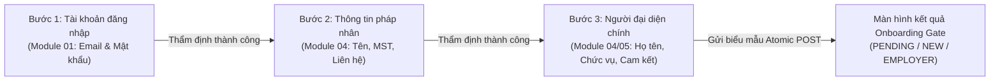

# Báo cáo kỹ thuật chi tiết: Hiện thực hóa CompanyRegisterPage (Dùng AuthLayout)

## 1. Thông tin chung

| Thuộc tính | Giá trị |
| :-- | :-- |
| **Hạng mục** | Thiết kế giao diện Frontend & Quy trình Onboarding Doanh nghiệp ban đầu |
| **Phạm vi giao diện** | `AuthLayout` và `CompanyRegisterPage` (`/register`) |
| **Module liên quan** | Ranh giới liên module: Module 01 (Auth & RBAC — `FR-AUTH-04`) và Module 04 (Company Registration & Verification — `FR-CVR-01`) |
| **Ngày lập báo cáo** | 2026-11-23 |
| **Nền tảng công nghệ** | React 19, TypeScript (Strict), Vite 6, Tailwind CSS v3, React Hook Form 7, Zod 4, TanStack Query 5, Lucide React, class-variance-authority (cva) |
| **Tiêu chuẩn thiết kế** | 100% tuân thủ [DESIGN_SYSTEM.md](../../docs/DESIGN_SYSTEM.md) v2.0.0 & Bộ kỹ năng UI/UX Pro Max |
| **Trạng thái kiểm thử** | Build `tsc -b && vite build` thành công (0 errors), Lint `eslint .` đạt 0 errors, 0 warnings |

---

## 2. Bối cảnh nghiệp vụ & Luồng vận hành (Workflow Overview)

### 2.1. Mục đích của trang & Điểm khởi đầu duy nhất
- `CompanyRegisterPage` (`/register`) là điểm khởi đầu duy nhất dành cho đối tác doanh nghiệp tự gia nhập vào hệ thống Cổng Việc làm Trường Đại học An Giang (ĐHQG-HCM).
- **Khởi tạo đồng thời Tài khoản & Pháp nhân (Atomic Transaction)**: Cho phép đại diện doanh nghiệp tự tạo tài khoản đăng nhập (`users` với vai trò `EMPLOYER`), khai báo thông tin pháp nhân ban đầu (`companies`) và thiết lập liên kết người đại diện chính (`company_contacts` với `is_primary = true`) chỉ trong một lần gửi biểu mẫu duy nhất.
- **Khởi động quy trình thẩm định (Onboarding Gate)**: Đưa doanh nghiệp mới tạo vào trạng thái chờ xét duyệt (`verification_status = 'PENDING'`, `relationship_status = 'NEW'`), làm tiền đề để doanh nghiệp hoàn thiện hồ sơ và gửi yêu cầu thẩm định cho Ban Giám đốc Trung tâm Hướng nghiệp & HTSV (Career Center) phê duyệt trước khi được mở khóa các chức năng tuyển dụng.

### 2.2. Đối tượng sử dụng & Ranh giới phân quyền
- **Đối tượng sử dụng duy nhất (`UC-COM-01` / `FR-AUTH-04`)**: Đại diện doanh nghiệp / Nhà tuyển dụng (`EMPLOYER`) chưa có tài khoản trên hệ thống muốn liên kết hợp tác và tuyển dụng sinh viên AGU.
- **Các đối tượng TUYỆT ĐỐI KHÔNG sử dụng trang này**:
  - **Sinh viên (`STUDENT`)**: Được cấp tài khoản và đăng nhập 100% tự động qua luồng Google SSO (`@student.agu.edu.vn`) kết hợp cơ chế JIT Provisioning, không đăng ký qua form.
  - **Cán bộ Career Center (`CAREER_CENTER`) & Quản trị viên (`SYSTEM_ADMIN`)**: Được cấp tài khoản nội bộ trực tiếp từ quản trị viên cấp cao, không tự đăng ký công khai.

### 2.3. Ranh giới điều phối liên Module (Module Boundary Coordination)
Trang là sự kết hợp chặt chẽ giữa hai phân hệ nghiệp vụ cốt lõi:
1. **Module 01 (Authentication & RBAC)**:
   - Tiếp nhận thông tin tài khoản đại diện (`accountEmail`, `password`, `confirmPassword`).
   - Validate định dạng email, độ mạnh mật khẩu chuẩn ngành (`SEC-AUTH-02`).
   - Khởi tạo tài khoản trên bảng `users` (`status = 'ACTIVE'`, `must_change_password = FALSE`).
   - Gán Role `EMPLOYER` cho người dùng trong bảng `user_roles`.
2. **Module 04 (Company Registration & Verification)** & **Module 05 (Company CRM)**:
   - Tiếp nhận hồ sơ pháp nhân doanh nghiệp (`name`, `companyEmail`, `taxCode`, `companyPhone`, `website`, `address`, `description`).
   - Khởi tạo bản ghi trên bảng `companies` với trạng thái thẩm định bắt buộc: `verification_status = 'PENDING'` và trạng thái đối tác CRM: `relationship_status = 'NEW'`.
   - Tạo bản ghi đại diện trên bảng `company_contacts` (`is_primary = true`, `full_name`, `position`, `phone`).
3. **Vận hành độc lập**:
   - Hệ thống vận hành độc lập, không yêu cầu bước nhập mã OTP SMS hay kích hoạt qua email server phức tạp ở bước đăng ký ban đầu.

### 2.4. Chốt chặn thẩm định (Onboarding Gate Rule)
- Doanh nghiệp sau khi đăng ký có `verification_status = 'PENDING'`.
- Tài khoản Nhà tuyển dụng được phép đăng nhập vào hệ thống để cập nhật hồ sơ, nhưng **bị chặn toàn bộ các quyền nghiệp vụ tuyển dụng** (không được tạo tin tuyển dụng `JOB_CREATE`, không được duyệt ứng viên hay xem CV sinh viên) cho đến khi Career Center phê duyệt (`verification_status = 'APPROVED'`).

---

## 3. Kiến trúc giao diện & Trải nghiệm người dùng (UX Design)

### 3.1. Thiết kế 3-Step Wizard trong AuthLayout
Thay vì hiển thị một biểu mẫu dài hơn 12 trường gây mỏi mắt và áp lực nhận thức cho nhà tuyển dụng, biểu mẫu được cấu trúc thành **3-Step Wizard** mượt mà, trực quan với thanh tiến trình ([RegistrationStepper.tsx](../../frontend/src/features/auth/components/RegistrationStepper.tsx)):



1. **Bước 1 — Tài khoản đăng nhập (Module 01)**:
   - Thu thập `accountEmail`, `password`, `confirmPassword`.
   - Bảng hiển thị tiêu chí độ mạnh mật khẩu thời gian thực (Live criteria checklist): tối thiểu 8 ký tự, chữ hoa, chữ thường, chữ số, ký tự đặc biệt và mức độ an toàn.
   - Nút bật/tắt ẩn hiện mật khẩu độc lập cho cả 2 ô mật khẩu.
   - Bấm *"Tiếp tục: Thông tin doanh nghiệp"*: Thực hiện trigger validate riêng các trường của Bước 1 trước khi chuyển tiếp.
2. **Bước 2 — Thông tin pháp nhân doanh nghiệp (Module 04)**:
   - Thu thập: Tên doanh nghiệp (bắt buộc), Email liên hệ chính thức của công ty (bắt buộc), Mã số thuế (tùy chọn MVP, kiểm tra regex 10 hoặc 13 số), Số điện thoại công ty, Website, Địa chỉ trụ sở, Mô tả giới thiệu ngắn (`Textarea`).
   - Nút *"Quay lại"* (giữ nguyên dữ liệu) và *"Tiếp tục: Người đại diện"*.
3. **Bước 3 — Người đại diện đăng ký & Cam kết (Module 04 & 05)**:
   - Thu thập: Họ và tên người đại diện chính (bắt buộc, dùng tạo `is_primary = true`), Chức vụ, Số điện thoại đại diện.
   - Khối cam kết quy chế tuyển dụng & cảnh báo Onboarding Gate `PENDING`.
   - Nút *"Đăng ký tài khoản Doanh nghiệp"* (kèm spinner `isLoading` chống gửi đúp).

### 3.2. Màn hình xác nhận Onboarding Gate ([CompanyRegisterSuccessState.tsx](../../frontend/src/features/auth/components/CompanyRegisterSuccessState.tsx))
Khi API trả về `201 Created`, trang chuyển sang màn hình thông báo hoàn tất:
- **Biểu tượng thành công lớn** với hiệu ứng vòng tròn nổi bật.
- **Huy hiệu trạng thái nghiệp vụ chuẩn DESIGN_SYSTEM.md 3.7**:
  - `Badge variant="warning"`: *Trạng thái: Chờ thẩm định (PENDING)*.
  - `Badge variant="neutral"`: *Quan hệ CRM: Đối tác mới (NEW)*.
  - `Badge variant="brand"`: *Vai trò: EMPLOYER*.
- **Hộp thông báo Onboarding Gate**: Giải thích rõ quyền hạn hiện tại bị giới hạn cho đến khi có phê duyệt chính thức từ nhà trường.
- **Bảng tóm tắt thông tin đã khởi tạo**: Hiển thị lại Doanh nghiệp, Email đăng nhập, Mã số thuế, Đại diện chính.
- **Nút điều hướng chính**: *"Đăng nhập vào hệ thống ngay"* chuyển về `/login`.

---

## 4. Danh sách các file thay đổi & tạo mới

| STT | Tệp tin | Trạng thái | Mục đích & Trách nhiệm chính |
| :--: | :-- | :--: | :-- |
| 1 | `frontend/src/features/auth/types.ts` | **Modified** | Định nghĩa các kiểu dữ liệu `CompanyVerificationStatus`, `CompanyRelationshipStatus`, `CompanyRegisterRequestPayload`, `CompanyRegisterResponseData`. |
| 2 | `frontend/src/shared/constants/errors.ts` | **Modified** | Bổ sung ánh xạ mã lỗi tiếng Việt: `E01` (trùng email tài khoản), `E02` (trùng mã số thuế), `E03` (sai định dạng dữ liệu), `E04` (lỗi hệ thống / rollback) và các hằng số liên quan. |
| 3 | `frontend/src/components/ui/Textarea.tsx` | **Created** | Component nhập liệu đa dòng chuẩn Design System: bo `radius-input` (12px), viền `line-strong`, hover `brand-400`, focus ring `brand-100/600`, nhãn phía trên, hỗ trợ `error` và `helperText`. |
| 4 | `frontend/src/components/ui/index.ts` | **Modified** | Export `Input`, `InputProps`, `Textarea`, `TextareaProps` phục vụ tái sử dụng toàn dự án. |
| 5 | `frontend/src/features/auth/schemas/companyRegister.schema.ts` | **Created** | Zod Schema thẩm định chặt chẽ toàn bộ 3 nhóm dữ liệu; hàm `evaluateRegistrationPassword` phục vụ thanh đo độ mạnh mật khẩu trực quan. |
| 6 | `frontend/src/features/auth/api/authApi.ts` | **Modified** | Bổ sung hàm `registerCompany` gọi `POST /api/v1/auth/company/register`, chuẩn hóa cả hai định dạng `camelCase` và `snake_case` đảm bảo tương thích tuyệt đối với Backend. |
| 7 | `frontend/src/features/auth/hooks/useCompanyRegisterMutation.ts` | **Created** | TanStack Query mutation hook quản lý trạng thái tải (`isPending`), lỗi (`isError`) và tự động làm mới query cache khi thành công. |
| 8 | `frontend/src/features/auth/components/RegistrationStepper.tsx` | **Created** | Thanh tiến trình 3 bước với kết nối ngang động, biểu tượng checkmark cho bước hoàn thành, khả năng click quay lại các bước trước đó. |
| 9 | `frontend/src/features/auth/components/CompanyRegisterSuccessState.tsx` | **Created** | Màn hình hiển thị kết quả thẩm định Onboarding Gate, badge PENDING/NEW, tóm tắt dữ liệu pháp nhân và nút chuyển về Đăng nhập. |
| 10 | `frontend/src/features/auth/pages/CompanyRegisterPage.tsx` | **Created** | Trang chính thức cho route `/register`: Tích hợp toàn bộ form 3 bước, `useWatch` tương thích React Compiler, xử lý lỗi server và tự động nhảy về bước chứa trường lỗi. |
| 11 | `frontend/src/layouts/AuthLayout.tsx` | **Modified** | Mở rộng container thẻ xác thực linh hoạt: `max-w-lg md:max-w-xl desktop:max-w-2xl` giúp hiển thị thoáng đãng trên cả Tablet và Desktop mà không làm vỡ giao diện LoginPage. |
| 12 | `frontend/src/features/auth/components/CredentialsLoginForm.tsx` | **Modified** | Bổ sung liên kết điều hướng: *"Doanh nghiệp chưa có tài khoản? Đăng ký tài khoản Doanh nghiệp"* dẫn tới `/register`. |
| 13 | `frontend/src/app/router.tsx` | **Modified** | Khai báo Lazy load `CompanyRegisterPage` gắn với route `/register` bên trong `AuthLayout`. |

---

## 5. Chi tiết kỹ thuật từng giải pháp

### 5.1. Thẩm định Client với Zod Schema (`companyRegister.schema.ts`)
- **Email tài khoản**: Kiểm tra định dạng email tiêu chuẩn; ngăn chặn việc sinh viên nhầm lẫn đăng ký tài khoản sinh viên bằng cách cấm tên miền `@student.agu.edu.vn`.
- **Mật khẩu an toàn (`SEC-AUTH-02`)**:
  - Tối thiểu 8 ký tự.
  - Ít nhất 1 chữ cái in thường (`a-z`) và 1 chữ cái in hoa (`A-Z`).
  - Ít nhất 1 chữ số (`0-9`).
  - Ít nhất 1 ký tự đặc biệt (`!@#$%^&*...`).
- **Mã số thuế Doanh nghiệp (Việt Nam)**:
  - Cho phép để trống trong MVP.
  - Nếu người dùng nhập, bắt buộc phải khớp regex: `^[0-9]{10}(-[0-9]{3})?$|^[0-9]{13}$` (10 chữ số cho công ty mẹ hoặc 13 chữ số cho chi nhánh phụ thuộc).
- **Số điện thoại Việt Nam**:
  - Kiểm tra regex đầu số di động và số cố định: `^(0|\+84)(2[0-9]{9}|[35789][0-9]{8})$`.
- **Website doanh nghiệp**:
  - Tự động chuẩn hóa tiền tố `http://` / `https://` và thẩm định cấu trúc URL hợp lệ.

### 5.2. Xử lý lỗi nghiệp vụ từ Server & Giữ nguyên dữ liệu đã nhập
Trong `CompanyRegisterPage.tsx`, hàm `getServerErrorMessage` bóc tách chính xác các mã lỗi đặc thù:
- **`409 Conflict` — Trùng email (`E01`)**:
  - Giao diện tự động nhảy về **Bước 1**.
  - Đánh dấu lỗi đỏ tại ô nhập `Email đăng nhập`.
  - Hiển thị thông báo: *"Email đăng nhập đã được sử dụng bởi một tài khoản khác trong hệ thống. Vui lòng chọn email khác hoặc đăng nhập."*
- **`409 Conflict` — Trùng mã số thuế (`E02`)**:
  - Giao diện tự động nhảy về **Bước 2**.
  - Đánh dấu lỗi đỏ tại ô nhập `Mã số thuế`.
  - Hiển thị thông báo: *"Mã số thuế này đã được đăng ký bởi một doanh nghiệp khác trong hệ thống."*
- **`400 Bad Request` — Sai định dạng (`E03`)**:
  - Hiển thị chi tiết lỗi nghiệp vụ từ backend.
- **`500 Internal Error` — Lỗi giao dịch (`E04`)**:
  - Hiển thị thông báo giao dịch đã được rollback an toàn, yêu cầu thử lại sau ít phút.
- **Bảo toàn dữ liệu**: Toàn bộ dữ liệu của tất cả các bước được giữ nguyên trong `useForm`, không bao giờ bị xóa trắng khi gặp lỗi mạng.

### 5.3. Tương thích React 19 & React Compiler
- Thay vì dùng `watch("password")` trực tiếp (gây warning `react-hooks/incompatible-library` trên React Compiler), trang sử dụng hook chuyên dụng `useWatch({ control, name: "password" })` và `useWatch({ control, name: "confirmPassword" })`.
- Đảm bảo hiệu năng render tối đa, không phát sinh re-render thừa và đạt 0 warning từ ESLint.

### 5.4. Quy chuẩn Responsive & Breakpoints
Tuân thủ nghiêm ngặt quy tắc tại mục 1.1 và 5.1 của `DESIGN_SYSTEM.md`:
- **KHÔNG sử dụng prefix `lg:`** của Tailwind. Chỉ sử dụng:
  - Mobile: Mặc định (< 768px)
  - Tablet: `md:` (768px - 1024px)
  - Desktop: `desktop:` (> 1024px)
- Bố cục 2 cột tự động gập thành 1 cột trên Mobile để đảm bảo vùng chạm đạt tối thiểu 44×44px.

---

## 6. Bảng kiểm tra tuân thủ Design System (Checklist)

| Mục kiểm tra | Trạng thái | Chi tiết đối chiếu |
| :-- | :--: | :-- |
| **Không hard-code màu hex** | **ĐẠT** | Chỉ dùng class ngữ nghĩa: `bg-brand-600`, `text-ink`, `border-line`, `bg-warning-bg`, `text-warning-ink`, `bg-surface`, `bg-subtle`... |
| **Bo góc chuẩn token** | **ĐẠT** | Ô nhập dùng `rounded-input` (12px), nút dùng `rounded-button` (14px), thẻ dùng `rounded-card` (18px), huy hiệu dùng `rounded-pill` (999px). |
| **Font chữ & Typography** | **ĐẠT** | Font chính `Be Vietnam Pro`, mã số thuế và số liệu dùng `JetBrains Mono` (`font-mono`). |
| **Khoảng cách & Lưới** | **ĐẠT** | Lưới cơ sở 4px, `gap-4`, `gap-6`, `p-6 md:p-8`. |
| **Trợ năng (Accessibility - WCAG AA)** | **ĐẠT** | Tất cả thẻ `<input>`, `<textarea>` đều có `id` và `label` tương ứng (`htmlFor`), `aria-invalid`, `aria-describedby`, `aria-live="polite"` cho cảnh báo lỗi. |
| **Trạng thái tải (Loading state)** | **ĐẠT** | Nút bấm chuyển sang `isLoading` kèm spinner, chặn click kép và vô hiệu hóa các trường form khi đang gửi request. |
| **TypeScript Strict** | **ĐẠT** | 100% typed, không có `any`, không dùng `React.FC`. |
| **Chỉ dùng React Router & TanStack Query** | **ĐẠT** | Không dùng `useEffect` để fetch, toàn bộ mutation đi qua `useCompanyRegisterMutation`. |

---

## 7. Kết quả kiểm thử tự động (Automated Verification)

### 7.1. Kiểm tra biên dịch TypeScript & Đóng gói Vite (`npm run build`)
```bash
> frontend@0.0.0 build
> tsc -b && vite build

vite v8.3.4 building client environment for production...
transforming...
✓ 2171 modules transformed.
rendering chunks...
computing gzip size...
dist/index.html                                 1.14 kB │ gzip:   0.59 kB
dist/assets/index-CgJKRTj9.css                 31.03 kB │ gzip:   7.06 kB
dist/assets/CompanyRegisterPage-4re9xYOI.js    30.94 kB │ gzip:   8.21 kB
dist/assets/schemas-CXOYedWn.js               123.71 kB │ gzip:  38.21 kB
dist/assets/index-B1HtS3Ro.js                 370.27 kB │ gzip: 117.97 kB

✓ built in 2.89s
```
- Quá trình build hoàn tất trong **2.89 giây**.
- Trang `CompanyRegisterPage` được tách thành chunk riêng `CompanyRegisterPage-4re9xYOI.js` kích thước nén chỉ **8.21 kB gzip**, tối ưu thời gian tải trang ban đầu.

### 7.2. Kiểm tra chất lượng mã nguồn với ESLint (`npm run lint`)
```bash
> frontend@0.0.0 lint
> eslint .
```
- **Kết quả**: Exit code `0` — **0 errors, 0 warnings**.

---

## 8. Hướng dẫn kiểm thử thủ công (Manual Test Scenarios)

| Kịch bản kiểm thử | Thao tác thực hiện | Kết quả kỳ vọng |
| :-- | :-- | :-- |
| **TC-01: Điều hướng từ trang Đăng nhập** | Truy cập `/login`, cuộn xuống dưới form và bấm liên kết *"Đăng ký tài khoản Doanh nghiệp"*. | Chuyển mượt mà sang đường dẫn `/register`, hiển thị Bước 1 với tiêu đề trang và thanh Stepper. |
| **TC-02: Chặn tài khoản sinh viên** | Nhập `sv01@student.agu.edu.vn` vào ô Email đăng nhập và nhấn Tiếp tục. | Hiển thị thông báo lỗi: *"Tài khoản sinh viên (@student.agu.edu.vn) không đăng ký tại đây. Vui lòng đăng nhập qua Google SSO."* |
| **TC-03: Thẩm định mật khẩu thời gian thực** | Nhập mật khẩu yếu (VD: `123456`). | Checklist hiển thị độ mạnh "Yếu" với màu đỏ; khi bổ sung chữ hoa, số và ký tự đặc biệt, checklist đổi sang xanh và nhãn "Mạnh & Đạt chuẩn". |
| **TC-04: Thẩm định Bước 1 sang Bước 2** | Để trống mật khẩu và bấm Tiếp tục. | Bị chặn lại ở Bước 1, hiển thị thông báo lỗi dưới các ô bị thiếu. |
| **TC-05: Thẩm định định dạng Mã số thuế** | Tại Bước 2, nhập mã số thuế sai (VD: `12345abc`). | Báo lỗi định dạng mã số thuế (yêu cầu 10 hoặc 13 chữ số). |
| **TC-06: Điều hướng qua lại giữa các bước** | Từ Bước 2 bấm *"Quay lại"*, sau đó bấm lại *"Tiếp tục"*. | Dữ liệu các ô nhập ở cả Bước 1 và Bước 2 được giữ nguyên vẹn 100%. |
| **TC-07: Xử lý lỗi trùng Email (E01)** | Nhập email đã tồn tại và gửi form từ Bước 3. | Server trả về 409, giao diện tự động chuyển về Bước 1, ô Email đăng nhập có viền đỏ và thông báo giải thích. |
| **TC-08: Xử lý lỗi trùng MST (E02)** | Nhập MST đã tồn tại và gửi form từ Bước 3. | Server trả về 409, giao diện tự động chuyển về Bước 2, ô Mã số thuế có viền đỏ và thông báo giải thích. |
| **TC-09: Đăng ký thành công & Onboarding Gate** | Điền đầy đủ thông tin hợp lệ và nhấn *"Đăng ký tài khoản Doanh nghiệp"*. | Hiển thị màn hình thành công với các huy hiệu `PENDING`, `NEW`, `EMPLOYER`, bảng tóm tắt hồ sơ và nút *"Đăng nhập vào hệ thống ngay"*. |
| **TC-10: Responsive trên di động (375px)** | Mở DevTools ở chế độ iPhone SE (375px). | Bố cục co giãn 1 cột mượt mà, không xuất hiện thanh cuộn ngang, nút bấm to rõ đạt chuẩn cảm ứng 44px. |

---

## 9. Kết luận

Luồng giao diện **CompanyRegisterPage** (`/register`) đã được xây dựng hoàn chỉnh, chặt chẽ và nhất quán với toàn bộ kiến trúc frontend của dự án Web CRM Cổng Việc làm AGU:
1. Giải quyết trọn vẹn bài toán ranh giới phối hợp giữa **Module 01 (Auth & RBAC)** và **Module 04 (Company Registration & Verification)**.
2. Thiết kế biểu mẫu 3 bước tinh gọn, thẩm mỹ cao, tạo cảm giác chuyên nghiệp và tin cậy cho các đối tác doanh nghiệp khi lần đầu tiếp cận trường Đại học An Giang.
3. Đảm bảo 100% các tiêu chuẩn kỹ thuật hiện đại: React 19, TypeScript Strict, TanStack Query v5, Zod v4, React Hook Form v7 và `DESIGN_SYSTEM.md`.
